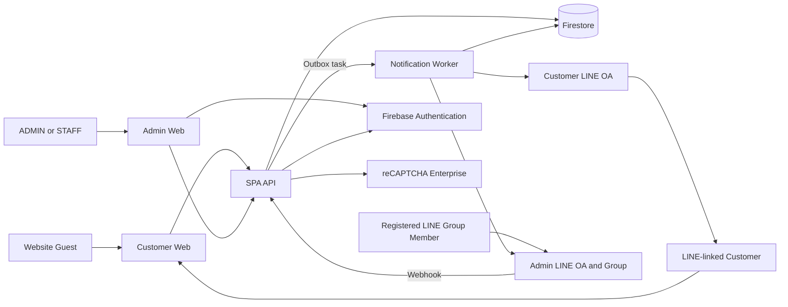
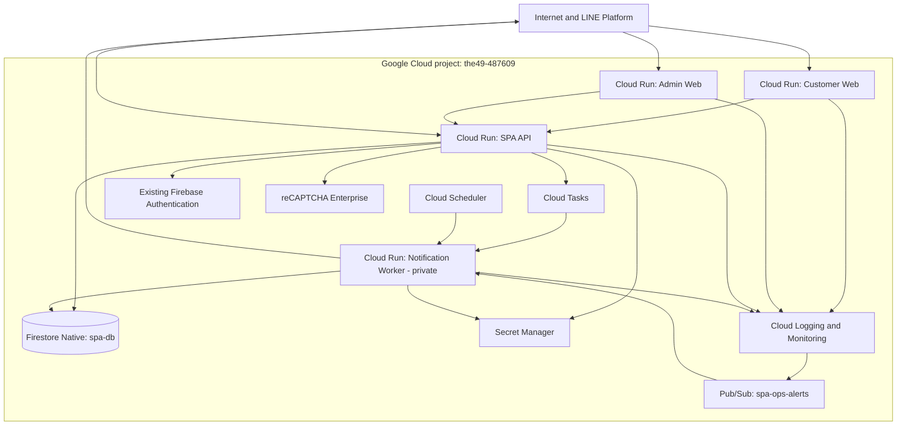
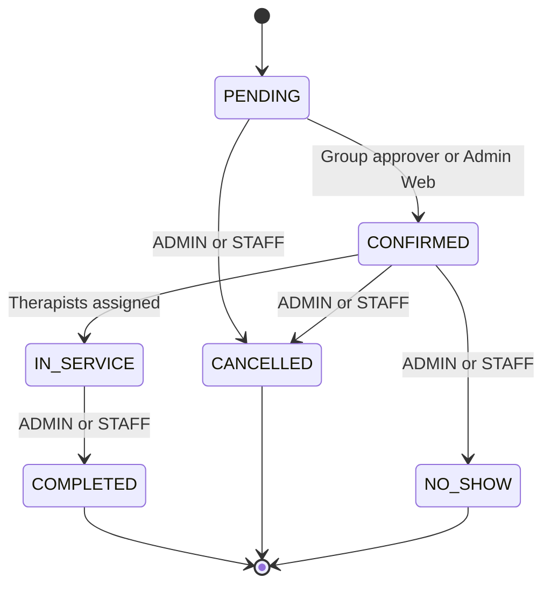

# SPA 49 — High-Level Design

| Item | Value |
| --- | --- |
| Product | SPA 49 Booking & Operations |
| Document | High-Level Design (HLD) |
| Version | 1.2 |
| Status | Approved architecture baseline |
| Last updated | 18 August 2026 |
| Initial branch scope | One branch |
| Timezone / currency | Asia/Bangkok / THB |
| Business baseline | [Business Logic v1.3](./BusinessLogic.md) |

## 1. Purpose

This document defines the Phase 1 high-level architecture for SPA 49. It translates the approved business rules into system boundaries, deployable applications, data ownership, identity boundaries, integration patterns, security controls, and operational targets.

This HLD intentionally does not define exact API payloads, Firestore document schemas, index definitions, UI component details, or deployment scripts. Those decisions belong in the Technical Design (TDD) and Low-Level Design (LLD).

## 2. Architecture Principles

1. **SPA is an isolated product inside the existing cloud project.** It lives under `SPA/` and uses SPA-prefixed deployables, a named Firestore database, dedicated secrets, queues, and runtime identities without sharing Receipt application data paths or service accounts.
2. **Business rules take precedence over prototypes.** Google Stitch is a read-only UX/UI reference. `SPA-Customer-Views` and `SPA-Admin-Views` do not define business behavior.
3. **All authoritative writes pass through the SPA API.** Browsers do not write directly to Firestore.
4. **Capacity consistency is stronger than notification consistency.** A Booking and its capacity reservation are committed atomically; LINE delivery is asynchronous and must never roll back a Booking.
5. **Collect the minimum customer identity data.** Phase 1 requires a nickname and phone number, plus a separate health declaration required for service safety.
6. **Support LINE and non-LINE customers.** LIFF/LINE Login improves identity and notifications but is not required for a Website Guest Booking.
7. **Enforce authorization at the API.** UI visibility is not a security control.
8. **Design for future branches without introducing Phase 2 features.** Every branch-owned record has a branch reference even though Phase 1 operates one branch.

## 3. Scope

### 3.1 In Scope

- Mobile-first customer booking through LINE Rich Menu/LIFF and a Public Website
- Website Guest booking without membership or OTP
- One or two participants per Booking
- Service and duration selection per participant with a shared start time
- Availability based on rooms, beds, service areas, blocked periods, and configured capacity
- `PENDING` capacity reservation with no automatic expiration
- Admin Web operations with `ADMIN` and `STAFF` roles
- Therapist management and post-booking therapist assignment
- Approval from a registered LINE Admin Group
- Customer LINE acknowledgements and status messages when LINE is linked
- Secure status tracking for Website Guests
- Pay-at-store workflow with no online payment
- Health-detail delivery to the access-controlled registered Admin LINE Group, while retaining masking in Customer LINE and customer status views
- Persistent customer health profiles with immutable visit-time snapshots and versioned consent evidence
- Audit trails, operational monitoring, backup, and recovery

### 3.2 Out of Scope

- Online payment, payment reconciliation, or receipt issuance
- Customer-selected therapists
- Customer self-service reschedule or cancellation
- Membership, visit rewards, birthday vouchers, CRM campaigns, and advanced analytics
- Therapist commission calculations
- BigQuery or an analytics warehouse
- Multi-branch operations in Phase 1
- SMS or email notifications
- Sharing Receipt deployables, Firestore collections, queues, secrets, or runtime service accounts

## 4. Approved Architecture Decisions

| ID | Decision |
| --- | --- |
| HLD-001 | Deploy SPA Phase 1 in the existing Google Cloud/Firebase project `the49-487609`. Isolate SPA through resource naming, service accounts, IAM, secrets, queues, and a named Firestore database rather than creating another project. |
| HLD-002 | Deploy regional resources in `asia-southeast1` and co-locate Cloud Run, Firestore, Cloud Tasks, and related services where supported. |
| HLD-003 | Create four independently deployable applications: Customer Web, Admin Web, SPA API, and Notification Worker. |
| HLD-004 | Use Next.js for both web applications and FastAPI for the API and Notification Worker. |
| HLD-005 | Use a Firestore Native-mode named database `spa-db` as the Phase 1 operational database. Keep the existing Receipt `(default)` database separate and do not add BigQuery in Phase 1. |
| HLD-006 | Support two customer access modes: verified LINE-linked access and anonymous Website Guest access. |
| HLD-007 | Use Firebase Authentication for invite-only Admin Web identities and enforce exactly two application roles: `ADMIN` and `STAFF`. |
| HLD-008 | Treat the registered Admin LINE Group as a separate authorization boundary from Admin Web RBAC. Membership is restricted operationally to authorized Admin/Staff bound by confidentiality obligations; the group may receive participant health details and confirm Bookings but grants no Admin Web access. |
| HLD-009 | Use a Customer LINE OA and a separate Admin LINE OA. Production values are held in Secret Manager; pre-production tests use separate test channels/groups even though they are hosted in the same GCP project. |
| HLD-010 | Use a Firestore transaction for Booking creation, Booking changes that affect capacity, and confirmation state transitions. |
| HLD-011 | Use a transactional outbox plus Cloud Tasks and a private Notification Worker for LINE delivery and retry. |
| HLD-012 | Store secrets in Secret Manager and assign a dedicated least-privilege service account to each Cloud Run service. |
| HLD-013 | Route Phase 1 operational alerts only to the registered LINE Admin Group; bridge Cloud Monitoring incidents through authenticated Pub/Sub delivery to the Notification Worker. |

## 5. System Context



### 5.1 External Actors and Systems

| Actor or system | Responsibility |
| --- | --- |
| Website Guest | Submits a Booking using nickname, phone number, and participant health declarations; tracks status with a secure link. |
| LINE-linked Customer | Uses LIFF/LINE Login or links LINE after booking and can receive Customer LINE OA messages. |
| `ADMIN` | Has all operational rights plus user, role, security, and system configuration rights. |
| `STAFF` | Manages bookings, customers, capacity, services, therapists, assignments, and branch operations, but not users, roles, or security configuration. |
| LINE Admin Group Approver | An authorized Admin/Staff operator in the active registered group can receive Booking and participant health details for service preparation and confirm a `PENDING` Booking. An Admin Web account is not required; employment confidentiality and group offboarding controls are mandatory. |
| LINE Platform | Provides LIFF/LINE Login, Messaging API delivery, group events, and webhook delivery. |
| Google Cloud | Hosts runtime, database, identity, task queue, secrets, observability, and protection services. |

## 6. Application and Repository Structure

The SPA codebase is a product boundary under `SPA/`. The following target layout is a high-level ownership model; exact package configuration is defined in TDD.

```text
SPA/
├── apps/
│   ├── customer-web/          # Next.js, mobile-first, public
│   └── admin-web/             # Next.js, desktop-first, authenticated
├── services/
│   ├── api/                   # FastAPI, business rules and integrations
│   └── notification-worker/   # FastAPI, private task receiver and reconciliation
├── packages/
│   └── shared-contracts/      # Shared generated or framework-neutral contracts
└── Document/
    ├── BusinessLogic.md
    ├── HLD.md
    └── DESING/
```

The existing root `frontend/` and `backend/` remain Receipt application components. SPA services must not import Receipt application modules or depend on Receipt deployment state.

## 7. Deployable Components

### 7.1 Customer Web

**Technology:** Next.js, deployed as a public Cloud Run service.

Responsibilities:

- Present the approved mobile-first journey: Service → Pax → Date/Time → Customer Data → Review → Submit
- Support LIFF browser, ordinary mobile browser, and desktop browser
- Obtain a LINE credential when the customer chooses LINE Login
- Collect only nickname and phone as required identity fields
- Collect the required health declaration separately for each participant
- Request available slots from the SPA API
- Obtain a reCAPTCHA token for Guest submission
- Display Booking ID, `PENDING` acknowledgement, and a Secure Status Link
- Offer optional LINE account linking after a Guest Booking

The Customer Web holds no database credential and cannot decide that capacity is available. Availability displayed by the UI is advisory until the SPA API completes the submit transaction.

### 7.2 Admin Web

**Technology:** Next.js, deployed as a public Cloud Run service with authenticated application routes.

Responsibilities:

- Authenticate invited users with Firebase Authentication
- Present calendars, lists, schedules, Pending Queue, and Unassigned Queue
- Support booking confirmation, cancellation, status progression, and capacity-safe edits
- Manage services, duration variants, prices, resources, blocked periods, therapists, and the Phase 1 branch
- Display health details only to authorized `ADMIN` or `STAFF` users
- Restrict user, role, and security configuration screens to `ADMIN`
- Display notification failures, audit context, and integration health

The Admin Web may hide actions by role for usability, but the SPA API remains the authoritative authorization layer.

### 7.3 SPA API

**Technology:** FastAPI, deployed as a Cloud Run service.

Responsibilities:

- Expose public customer, Guest status, authenticated admin, and LINE webhook endpoints
- Verify LINE credentials on the server and never trust a raw profile supplied by a browser
- Verify Firebase ID tokens and application roles for Admin Web operations
- Enforce CAPTCHA, rate limits, duplicate protection, and active `PENDING` limits for Guest submission
- Calculate availability using branch configuration, resources, blocks, duration, buffer, and existing reservations
- Execute atomic Booking and capacity transactions
- Enforce the Booking state machine and all role permissions
- Validate LINE webhook signatures, registered Group IDs, and approver User IDs
- Write notification outbox events and audit entries
- Return only privacy-filtered views appropriate to each caller

The SPA API is internet reachable because it serves browsers and LINE webhooks. Public reachability does not imply unrestricted operations: every route has an explicit authentication and authorization policy.

### 7.4 Notification Worker

**Technology:** FastAPI, deployed as an IAM-protected Cloud Run service.

Responsibilities:

- Receive authenticated Cloud Tasks requests
- Claim an outbox event idempotently
- Render approved LINE Flex or text messages
- Send messages through the correct Customer or Admin LINE OA
- Record delivery attempts and terminal outcomes
- Retry transient delivery failures without repeating Booking state changes
- Reconcile committed outbox events that were not enqueued because of a process interruption

The Notification Worker is not publicly invokable. Cloud Tasks and Cloud Scheduler use service identities authorized to invoke only the required worker endpoints.

## 8. Deployment Topology

SPA Phase 1 uses one existing Google Cloud/Firebase project. Production workloads are isolated from the Receipt application through dedicated SPA resources. Local development uses emulators and synthetic data; any cloud integration test uses explicit `spa-*-test` resources and non-production LINE channels in the same project.



### 8.1 Environment Isolation

| Concern | Local / integration testing | Production |
| --- | --- | --- |
| Google Cloud project | Local Firebase Emulator Suite by default; scoped test resources in `the49-487609` only when required | `the49-487609` |
| Region | `asia-southeast1` | `asia-southeast1` |
| Data | Synthetic test data only, never copied from production | Named Firestore database `spa-db` |
| Firebase Auth | Emulator or dedicated test identities | Existing project Firebase Auth with SPA `app_users` authorization records |
| Customer LINE | Test channel/OA | Production Customer LINE OA |
| Admin LINE | Test channel/OA and test group | Production Admin LINE OA and registered group |
| Secrets | Test-specific secret names or local injected values | `spa-line-*` Secret Manager values with restricted access |
| Public URL | Localhost or test Cloud Run `run.app` URL | Cloud Run-generated `run.app` URLs; no custom domain in Phase 1 |
| Deployment approval | Automated local/CI validation | Controlled Cloud Run revision promotion |

Test code and identities must not read the production `spa-db` database. Production LINE credentials must never be used by local tests or CI message tests.

## 9. Identity and Authorization Architecture

### 9.1 Customer Access Modes

| Mode | Identity proof | Booking rights | Notification and status |
| --- | --- | --- | --- |
| Website Guest | No account; nickname and phone are contact data, not authentication | Can search availability and submit after abuse checks | Booking ID and Secure Status Link; phone fallback; no SMS |
| LINE-linked | Server-verified LINE credential or completed account-linking flow | Same Booking rights as Guest | Secure Status Link plus eligible Customer LINE OA messages |

For a LIFF/LINE Login flow, the client sends the LINE token to the SPA API over HTTPS. The API verifies the credential with LINE and derives the trusted LINE User ID. The API must not accept a client-supplied User ID or display name as verified identity.

A LINE-linked Booking can still receive a Secure Status Link. LINE delivery is best effort because delivery eligibility may change, for example when a user blocks the OA.

### 9.2 Guest Secure Status Link

The Secure Status Link is a bearer capability for one Booking, not a general customer account.

High-level controls:

- Generate a high-entropy, non-sequential token
- Store only a one-way token digest in Firestore
- Never include nickname, phone, health information, or an internal document path in the URL
- Return a privacy-minimized Booking view with masked contact data and no health detail
- Support revocation and replacement by an authorized Admin Web user
- Apply request rate limiting and security monitoring
- Define link lifetime and renewal behavior in TDD before production

### 9.3 Admin Web Authentication

- Admin users are invite-only Firebase Authentication users in the SPA environment.
- The browser sends a Firebase ID token to the SPA API over HTTPS.
- The SPA API verifies token validity, project audience, issuer, expiry, and signature through the Firebase Admin SDK.
- The API loads the active application user and role before authorizing each privileged operation.
- Disabled users are denied even if they still hold a previously issued client token.
- Role changes and account disablement are audit events.

SPA roles may use the same names as the Receipt product, but identities and permission records are not shared across cloud projects in Phase 1.

### 9.4 Application Role Matrix

| Capability | `ADMIN` | `STAFF` | LINE Group Approver |
| --- | :---: | :---: | :---: |
| View and operate Bookings | Yes | Yes | No |
| View customer and health details in Admin Web | Yes | Yes | No |
| Receive current Booking and participant health details in registered Admin Group | If a current authorized group member | If a current authorized group member | Yes |
| Confirm or cancel in Admin Web | Yes | Yes | No |
| Manage capacity, services, therapists, assignments, and branch operations | Yes | Yes | No |
| Manage users and roles | Yes | No | No |
| Manage security and integration configuration | Yes | No | No |
| Confirm a `PENDING` Booking from a registered LINE Group | If an identifiable group member | If an identifiable group member | Yes |

Registered Admin Group membership grants access only to the Booking summary and participant health details delivered into that group. It does not grant Admin Web access, historical health-profile access, configuration rights, or access to any other Booking outside delivered messages.

### 9.5 LINE Admin Group Authorization

The Admin LINE OA webhook is a public API endpoint protected by LINE webhook signature verification. A confirmation command is accepted only when all of the following are true:

1. The webhook signature is valid for the Admin LINE channel.
2. The event source is a group.
3. The Group ID is active in the registered group configuration.
4. The event contains the User ID of the member who triggered the action.
5. The command references an existing `PENDING` Booking.
6. The atomic state transition succeeds.

The first valid confirmation wins. Repeated commands return the latest state without applying the transition again. Public confirmation URLs are prohibited.

## 10. Core Booking Flow

```mermaid
sequenceDiagram
    actor Customer
    participant Web as Customer Web
    participant API as SPA API
    participant Protect as LINE or reCAPTCHA
    participant DB as Firestore
    participant Task as Outbox and Cloud Tasks

    Customer->>Web: Select service, pax, date/time, and details
    Web->>API: Request availability
    API->>DB: Read active services, resources, blocks, and reservations
    API-->>Web: Available slots

    alt LINE-linked submission
        Web->>API: Submit with LINE credential
        API->>Protect: Verify LINE credential
        Protect-->>API: Trusted LINE User ID
    else Website Guest submission
        Web->>API: Submit with reCAPTCHA token
        API->>Protect: Create server-side assessment
        Protect-->>API: Validity and risk result
        API->>DB: Check rate, duplicate, and active Pending rules
    end

    API->>DB: Transaction: recheck capacity, create Booking and reservations, write audit and outbox
    alt Capacity is available
        DB-->>API: Commit PENDING Booking
        API->>Task: Enqueue notification event after commit
        API-->>Web: Booking ID, PENDING, Secure Status Link
    else Capacity changed
        DB-->>API: Reject transaction
        API-->>Web: Slot unavailable; select another slot
    end
```

The initial availability result is never a reservation. Capacity is reserved only by the successful submit transaction.

## 11. Availability and Capacity Architecture

### 11.1 Availability Inputs

Availability is calculated from:

- Branch operating hours, timezone, holidays, and special closures
- Configured minimum and maximum advance-booking windows
- Active service and duration variants
- Resource compatibility between services and rooms, beds, or service areas
- Resource capacity and blocked periods
- Service duration and configured buffer time
- Existing reservations for `PENDING`, `CONFIRMED`, and `IN_SERVICE` Bookings
- Both participants when pax is two, including different service durations

Therapist schedules do not affect customer availability in Phase 1.

### 11.2 Reservation Model

The API represents the required capacity across resource-time reservation records. Exact time-bucket size and Firestore document shape are TDD decisions.

For every capacity-affecting operation, a Firestore server transaction must:

1. Read the latest resource configuration and relevant reservation records.
2. Verify that all required intervals have sufficient capacity.
3. Write or update the Booking snapshot.
4. Write all participant resource reservations.
5. Write the audit event and notification outbox event when applicable.

Concurrent submissions contend on the relevant reservation records. The first transaction that commits obtains the capacity; a conflicting transaction is retried against current data and rejected if capacity is no longer available.

### 11.3 `PENDING` Policy

- A newly committed Booking is always `PENDING`.
- `PENDING` consumes capacity immediately.
- There is no automatic expiration or scheduled release.
- Capacity is released only when the Booking moves to a non-consuming terminal state.
- The Admin Web must emphasize aging `PENDING` Bookings and capacity impact.
- Guest abuse controls reduce malicious holds but do not alter the no-expiration rule.

This is an accepted operational risk and must be measured with Pending age and capacity-held dashboards.

## 12. Booking Lifecycle



State transitions are API commands, not direct field edits. Every transition records actor type, actor identifier, timestamp, previous state, new state, and relevant reason. Repeated or stale commands are idempotent or rejected without duplicate effects.

## 13. LINE Integration Architecture

### 13.1 Channel Separation

The production deployment uses:

- **Customer LINE OA:** Customer LIFF/LINE Login and Messaging API channels. Customer channels must be under the same LINE Provider so the verified User ID is consistent for linking and messaging.
- **Admin LINE OA:** A separate Messaging API channel invited to the registered Admin LINE Group.

Test and production channels, secrets, OAs, LIFF endpoints, and Group IDs must remain separate even though cloud resource ownership is in one GCP project.

### 13.2 Admin Group Booking Summary

After Booking commit, the Notification Worker sends a Flex summary containing Booking ID, `PENDING` state, nickname, phone, appointment, service/duration per participant, pax, participant health details supplied by the customer, call action, and confirmation message action.

Health detail is rendered only for the registered Admin Group destination loaded from protected configuration. The Worker reads the restricted health snapshot at render time; the outbox event and Cloud Task contain references only. Customer messages, other groups, operational alerts, URLs, logs, metrics, and audit summaries must not contain the detail.

### 13.3 Customer Messages

For an eligible LINE-linked Booking, the worker sends:

- A `PENDING` acknowledgement after the request is accepted
- A confirmation Flex after the Booking becomes `CONFIRMED`
- An updated summary after material appointment changes
- A cancellation message containing only a customer-safe reason

Website Guests receive the same status through the Secure Status Link. A Guest may link LINE after Booking; successful linking enables subsequent events but does not replay messages by default unless TDD explicitly permits a safe acknowledgement.

LINE push failure does not change Booking status. The Admin Web displays a delivery failure and the store may call the customer.

### 13.4 Webhook Processing

- Preserve the raw request body until the LINE signature is verified.
- Acknowledge valid webhooks promptly and process non-critical response messaging asynchronously.
- Deduplicate webhook events by a stable event identifier or derived idempotency key.
- Record security-relevant rejection reasons without logging message secrets or health data.
- Enforce independent channel secrets for Customer and Admin LINE endpoints.

## 14. Notification Reliability

### 14.1 Transactional Outbox

Firestore cannot atomically commit a database transaction and an external LINE API request. Therefore, the Booking transaction writes a durable outbox event in the same transaction as the Booking state change.

After commit:

1. The SPA API attempts to enqueue a Cloud Task using the outbox event key.
2. Cloud Tasks invokes the private Notification Worker with IAM authentication.
3. The worker atomically claims the event and calls LINE.
4. The worker records attempt count, provider result, and terminal state.
5. Transient failures are retried; permanent failures become visible in Admin Web.
6. Cloud Scheduler invokes the worker reconciliation endpoint to re-enqueue committed outbox events that have no active task.

Task retry configuration, reconciliation frequency, terminal error classification, and message-retention policy are defined in TDD.

### 14.2 Idempotency

- Each business event has a stable idempotency key.
- A task retry cannot repeat a Booking state transition.
- The worker checks delivery state before sending.
- Group confirmation is an atomic compare-and-transition from `PENDING`.
- The API supports a client submission idempotency key to reduce duplicate Booking creation after network retries.

## 15. Data Architecture

Firestore is the system of record for Phase 1 operational data. Clients access it only through the SPA API.

| Domain | High-level contents |
| --- | --- |
| Branch configuration | Branch identity, Asia/Bangkok timezone, operating hours, holidays, advance window, map/contact data |
| Service catalog | Service, duration variant, price, active state, resource compatibility |
| Resources and blocks | Rooms, beds, service areas, capacity, blocked periods, buffer configuration |
| Bookings | Booking number, branch, contact snapshot, state, appointment, totals, source, timestamps |
| Booking line items | Service/variant snapshot, pricing mode, required pax, quantity, and price charged once per sellable item |
| Participants | Nickname, selected line-item reference, required health snapshot, assigned resource and therapist references |
| Resource-time reservations | Capacity consumption for the complete participant intervals |
| Customers and LINE links | Minimal reusable contact identity, optional verified LINE User ID, linking and merge status |
| Customer health profiles | Current reusable health declaration, consent evidence, retention state, and last completed-visit anchor |
| Guest access | Secure Status Link token digest, state, issue/revoke metadata |
| Therapists and assignments | Therapist operational record and participant assignment |
| App users | Firebase UID, active state, `ADMIN` or `STAFF` role, branch scope |
| LINE configuration | Registered Group IDs, channel reference, active state; channel secrets remain in Secret Manager |
| Notification outbox | Event type, audience, payload reference, idempotency key, delivery state, attempts |
| Audit trail | Actor, action, entity, before/after summary, time, correlation ID |
| Abuse controls | Configurable policies, hashed enforcement keys where appropriate, counters, blocks, and expiry metadata |

### 15.1 Data Rules

- Every operational entity that belongs to a branch includes a Branch ID.
- Booking and participant service names, durations, and prices are snapshots; later catalog edits do not rewrite history.
- `PER_BOOKING` Couple Package is charged once while capacity and participant safety data are represented for both participants.
- Current Health Profile is stored separately from Booking Health Snapshots. Profile edits never rewrite historical snapshots.
- Health detail is stored separately from customer-safe summaries. The Admin Group Worker joins it only at render time and does not copy it into outbox or task payloads.
- Verified LINE User ID may link a profile automatically; phone-only Guest records require staff verification before profile merge.
- Public Booking numbers are not Firestore document IDs and do not grant access.
- Secure-link tokens, LINE channel secrets, and Firebase credentials are never stored in a client-readable document.
- Exact collection names, subcollection decisions, document limits, indexes, and retention jobs are TDD scope.

## 16. Security and Privacy Architecture

### 16.1 Security Controls

- HTTPS for all browser, LINE, and service communication
- Server-side LINE token verification and webhook signature validation
- Server-side Firebase ID token verification and role enforcement
- Backend-created reCAPTCHA assessment for Guest submission
- API-level rate limiting, duplicate checks, active `PENDING` limits, and phone-block controls
- Exact-origin CORS allowlists per environment
- Dedicated service accounts with least-privilege IAM
- IAM-authenticated Cloud Tasks and Cloud Scheduler invocation
- Secret Manager for LINE secrets, signing material, and other runtime secrets
- SPA-prefixed resources, dedicated service identities, a named database, and environment-specific integration credentials inside `the49-487609`
- Structured audit events for privileged actions and sensitive-data access
- Dependency, container, and deployment scanning in CI/CD

### 16.2 Health Information

- A health declaration is required for each participant; selecting “none” is a valid response.
- Booking/privacy acknowledgement and explicit health consent are separate, versioned, unchecked-by-default controls recorded per participant.
- Health details are available to authorized `ADMIN` and `STAFF` users in Admin Web and to authorized operators in the registered Admin LINE Group.
- The registered Admin LINE Group receives participant health details for service preparation. Group membership is an operational access-control list and leavers must be removed immediately.
- Customer LINE messages and Guest status views do not expose health details.
- Logs, URLs, metrics labels, error traces, and task names must not contain health details.
- Admin Web reads/updates and Admin Group disclosures are audited without copying health detail into audit records.
- `ADMIN` and `STAFF` may update the current Health Profile; each Booking preserves an immutable visit-time Health Snapshot.
- The proposed retention policy is three years after the customer's most recent `COMPLETED` visit or, if none exists, the latest authorized health collection/update. The anchor is renewed by a later completed visit or authorized update, followed by deletion or anonymization. It remains a production release gate pending Product Owner approval and privacy-notice review.
- Consent withdrawal, access restriction, deletion/anonymization, and legal-hold exceptions are explicit audited workflows rather than direct silent deletion.

### 16.3 Guest Abuse Controls

Guest submission passes through layered controls:

1. Server-validated reCAPTCHA assessment
2. Rate limits by IP-derived and phone-derived enforcement keys
3. Same-phone/date/time duplicate detection
4. Configurable maximum active `PENDING` Bookings per phone
5. Admin-managed phone block with reason and audit trail
6. Monitoring for spikes, repeated rejection, and capacity-hold anomalies

Raw IP addresses should not be retained longer than operationally necessary. Exact hashing, salt management, thresholds, retention, and user-facing recovery behavior are TDD decisions.

## 17. Non-Functional Requirements

These are the approved initial design targets, not contractual service limits.

| Category | Phase 1 target |
| --- | --- |
| Business volume | At least 100 Booking creations per day |
| Concurrent usage | At least 20 concurrent customer sessions plus normal Admin Web usage |
| Availability search | P95 response time no more than 2 seconds under the design load |
| Booking submission | P95 response time no more than 3 seconds, excluding asynchronous LINE delivery |
| Monthly application availability | 99.5% target |
| Consistency | No overbooking from concurrent successful writes; first committed transaction obtains capacity |
| Time semantics | All business calculations use `Asia/Bangkok`; persisted timestamps use UTC with branch timezone context |
| Backup | Daily Firestore scheduled backup or export with monitored completion |
| Recovery point objective | 24 hours |
| Recovery time objective | 4 hours |
| Audit retention | At least one year by default |
| Health-data retention | Proposed 3 years after latest `COMPLETED` visit or authorized health collection/update; configurable and approved before production |
| Accessibility | Customer mobile flow and Admin core operations target WCAG 2.1 AA behavior where applicable |

Cloud Run minimum instances, concurrency, CPU/memory, and maximum instances are tuned in TDD and load testing. The target traffic is low, but downstream Firestore contention and cost protection still require explicit limits.

## 18. Observability and Operations

### 18.1 Required Telemetry

- Structured application logs with correlation ID, route, result, latency, and actor type
- Metrics for availability latency and submit latency
- Booking creation and rejection counts by reason
- Firestore transaction retries and contention failures
- Pending Booking count, age bands, and capacity held
- Notification outbox age, queue depth, retries, and permanent failures
- LINE webhook signature failures and unregistered Group events
- Guest CAPTCHA and rate-limit decisions without exposing sensitive inputs
- Admin authentication and authorization failures
- Backup success, age, and restore-test status

### 18.2 Alerts

Initial operational alert categories:

- Elevated API 5xx rate or latency breach
- Booking transaction failure or contention spike
- Oldest unsent outbox event exceeds the agreed threshold
- LINE Admin Group delivery failure or invalid group configuration
- Repeated Customer LINE delivery failures requiring phone follow-up
- Excessive Guest abuse rejection or unusual `PENDING` growth
- Failed or missing daily backup
- Firestore, Cloud Tasks, or Cloud Run quota pressure

Phase 1 routes these operational alerts only to the registered LINE Admin Group. Customer Booking messages remain transactional customer notifications, not operational alerts. Thresholds and escalation ownership are TDD and runbook decisions.

## 19. Backup and Disaster Recovery

- Configure a daily Firestore scheduled backup for the production database.
- Monitor backup creation and retention; backup retention is approved before production.
- Keep configuration and infrastructure definitions in version control so services can be recreated.
- Store no durable application data on Cloud Run local filesystems.
- Restore Firestore into a new database during recovery, validate integrity, then switch application configuration through a controlled deployment.
- Test the restore procedure before launch and at a recurring operational interval.
- A LINE outage does not require database rollback; undelivered outbox events remain available for retry or manual follow-up.

The baseline is RPO 24 hours and RTO 4 hours. A future requirement for lower RPO or cross-region failover requires a separate architecture decision and cost review.

## 20. Delivery and Change Management

- Build and validate each of the four deployables independently.
- Pin dependencies with framework-native lock files.
- Run backend tests and frontend lint/build checks before promotion.
- Validate locally with emulators first, then use explicitly scoped test resources/channels before production revision promotion.
- Promote immutable artifacts to production after approval.
- Apply Firestore indexes, rules, queue configuration, IAM, secrets references, and service settings through explicit infrastructure configuration.
- Do not place secret values in source control, container images, CI logs, or client environment variables.
- Use gradual Cloud Run rollout and a documented rollback path where production risk warrants it.

## 21. Risks and Mitigations

| Risk | Consequence | High-level mitigation |
| --- | --- | --- |
| `PENDING` has no expiration | Capacity may remain unavailable indefinitely | Pending Queue, age metrics, alerts, Guest active-Pending limit, and operational ownership |
| Anonymous Guest booking | Spam can consume capacity | Backend CAPTCHA assessment, layered rate/duplicate limits, blocks, and monitoring |
| Firestore hot reservation documents | Transaction contention and higher latency | Time-partitioned reservation design, bounded transaction scope, load tests, and TDD review |
| LINE message delivery is not guaranteed | Customer or staff misses an update | Durable outbox, retries, status link, Admin failure visibility, and phone fallback |
| Any registered group member can confirm | Broad approval authority | Explicit group registration, verified User ID, audit trail, atomic transition, and restricted group membership managed by the store |
| Secure Status Link is forwarded | Unauthorized viewer sees appointment data | High-entropy token, minimized response, masked contact, rate limit, revocation, and expiry policy |
| Two OAs and test/production credentials in one project | Channel or secret misrouting | Explicit secret names, channel identity validation, test-only groups, and deployment checks |
| SPA and Receipt share one GCP/Firebase project | Accidental data or IAM coupling | Named Firestore database `spa-db`, SPA-prefixed resources, dedicated service accounts, closed client rules, and scoped IAM |
| Health data leaks into logs or messages | Privacy and customer-safety impact | Separate data projection, log redaction, prohibited fields, access audit, and tests |
| Admin role token becomes stale | Revoked privilege remains usable temporarily | Server-side active-user check, short token lifecycle, revocation handling, and audit |
| One-region baseline | Regional outage can exceed availability target | Daily backup, infrastructure-as-code, recovery runbook; multi-region is a future decision |

## 22. Business Traceability

| Business rule | HLD realization |
| --- | --- |
| `BL-BKG-001`–`BL-BKG-003` | Customer Web journey, dual entry modes, one/two participants, no customer therapist selection |
| `BL-BKG-004`–`BL-BKG-005` | Transactional creation as `PENDING`, resource reservations, no automatic expiration |
| `BL-BKG-006`–`BL-BKG-008` | Guest minimum data, Secure Status Link, server-side CAPTCHA and abuse controls |
| `BL-CAP-001`–`BL-CAP-003` | Firestore resource-time transactions, complete-duration validation, block handling |
| `BL-ADM-001`–`BL-ADM-003` | Registered group verification, identifiable approver, atomic confirmation, audit |
| `BL-ADM-004`–`BL-ADM-005` | Two Admin Web roles and separate LINE Group authorization boundary |
| `BL-LINE-001` | Registered Admin Group Flex joins participant health snapshots at render time while customer/task/log projections remain masked |
| `BL-LINE-002`–`BL-LINE-003` | Conditional Customer LINE acknowledgement and confirmation Flex |
| `BL-LINE-004` | Transactional outbox and notification failures that do not roll back state |
| `BL-LINE-005` | Optional post-booking LINE account linking |
| `BL-LINE-006` | Operational alert renderer targets only the registered LINE Admin Group |
| `BL-OPS-001`–`BL-OPS-002` | Admin assignment before service; no customer self-service changes |
| `BL-PAY-001` | No payment component or online payment state in Phase 1 |
| `BL-PRI-001`–`BL-PRI-003` | API privacy projections, profile/snapshot separation, versioned explicit consent, masked external views, and authorized health access |
| `BL-CAT-001` | Versioned initial service seed with line-item pricing mode and required-pax constraints |

## 23. Decisions Deferred to TDD

The following are not blockers to this HLD but must be resolved before implementation:

- Exact REST endpoint and event contracts, versioning, and error model
- Firestore collections, document keys, indexes, transaction read/write sets, and time-bucket granularity
- Resource allocation algorithm when multiple compatible rooms or beds are available
- Guest client idempotency-key lifecycle
- reCAPTCHA key type, score/challenge thresholds, and recovery UX
- IP/phone rate windows, active `PENDING` limit, counter storage, hashing, and retention
- Secure Status Link entropy, digest algorithm, lifetime, renewal, and revocation workflow
- Firebase sign-in provider, invitation flow, token revocation checks, and role-cache strategy
- Cloud Tasks queue limits, retry/backoff, task naming, and dead-letter operational procedure
- Outbox reconciliation interval and concurrency controls
- LINE message schemas, size limits, localization, and exact account-linking flow
- Exact Cloud Run sizing, concurrency, minimum/maximum instances, and timeout values
- Cloud Run `run.app` URLs, exact CORS/CSP origins, and later custom-domain migration procedure
- Audit event schema and long-term retention implementation
- Final approval or revision of the proposed three-year health-data retention and deletion policy
- Backup retention, restore automation, and recovery runbook
- CI/CD provider, artifact registry, promotion approvals, and infrastructure tooling

## 24. References

### 24.1 Internal Sources

- [SPA 49 Business Logic](./BusinessLogic.md)
- [Customer Design](./DESING/Side-Customer/DESIGN.md)
- [Customer Stitch Flow](./DESING/Side-Customer/FLOW_STITCH.md)
- [Admin Design](./DESING/Side-Admin/DESIGN.md)
- [Admin Stitch Flow](./DESING/Side-Admin/FLOW_STITCH.md)

### 24.2 Google Cloud and Firebase

- [Cloud Run overview](https://cloud.google.com/run/docs/overview/what-is-cloud-run)
- [Cloud Run locations](https://cloud.google.com/run/docs/locations)
- [Cloud Run service identity](https://cloud.google.com/run/docs/securing/service-identity)
- [Cloud Run service-to-service authentication](https://cloud.google.com/run/docs/authenticating/service-to-service)
- [Firestore locations](https://firebase.google.com/docs/firestore/locations)
- [Manage multiple Firestore databases](https://firebase.google.com/docs/firestore/manage-databases)
- [Firestore transactions and batched writes](https://firebase.google.com/docs/firestore/manage-data/transactions)
- [Firestore transaction contention](https://firebase.google.com/docs/firestore/transaction-data-contention)
- [Firestore scheduled backups](https://cloud.google.com/firestore/docs/backups)
- [Firebase ID token verification](https://firebase.google.com/docs/auth/admin/verify-id-tokens)
- [Creating Cloud Tasks](https://cloud.google.com/tasks/docs/create-tasks)
- [Secret Manager best practices](https://cloud.google.com/secret-manager/docs/best-practices)
- [reCAPTCHA website assessments](https://cloud.google.com/recaptcha/docs/create-assessment-website)

### 24.3 LINE Platform

- [Using LIFF user profile information safely](https://developers.line.biz/en/docs/liff/using-user-profile/)
- [Getting LINE User IDs](https://developers.line.biz/en/docs/messaging-api/getting-user-ids/)
- [Linking LINE accounts](https://developers.line.biz/en/docs/messaging-api/linking-accounts/)
- [Receiving LINE webhook events](https://developers.line.biz/en/docs/messaging-api/receiving-messages/)
- [LINE Messaging API webhook events and actions](https://developers.line.biz/en/reference/messaging-api/nojs/)
- [LINE Messaging API group chats](https://developers.line.biz/en/docs/messaging-api/group-chats/)
