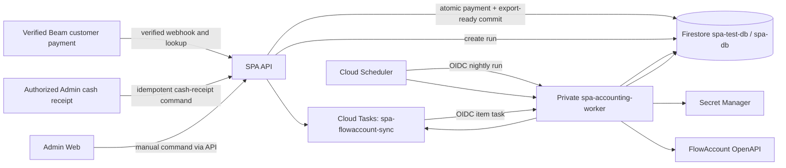

# SPA 49 — FlowAccount Sync Implementation Action Plan

| Item | Value |
| --- | --- |
| Status | Decision-complete implementation plan — FlowAccount Sandbox contract proof remains |
| Scope | SPA customer revenue from Beam/cash, FlowAccount Project `Spa 49`, nightly/manual export, Admin Payment & Accounting page |
| Source of financial truth | Authoritative SPA customer payment, not Booking state, browser redirect, or later branch cash deposit |
| Timezone / currency | `Asia/Bangkok` / THB |
| Last reviewed | 27 August 2026 |

## 1. Executive decision

Recommended implementation:

1. Create a durable `accounting_exports` record immediately when a customer payment becomes authoritative: verified Beam success or an authorized idempotent Admin cash-receipt event.
2. Delay only the external FlowAccount call. Do not delay local payment recording until the nightly run.
3. Use Cloud Scheduler for the recurring trigger and a private Accounting Worker plus Cloud Tasks for item-level delivery, retry, and rate control.
4. Schedule at **00:15 Asia/Bangkok for the previous business date** and always include older backlog.
5. Use the same sync engine for scheduled, full-manual, selected-row, and single-row actions. Admin UI must never call FlowAccount directly.
6. Export one accounting document per successful customer payment, preserving service line items and tip as separate lines.
7. Use a FlowAccount **Cash Invoice with payment**, `VAT 7% Inclusive`, Walk-in contact `ลูกค้าทั่วไป - SPA 49`, and FlowAccount Project `Spa 49`. Beam uses Other Channel `Beam/UOB Gateway - SPA 49`; customer cash uses Cash payment method.
8. Do not use FlowAccount's direct Receipt-create endpoints: FlowAccount announced those endpoints obsolete in November 2024.
9. Treat `Manee and Son Limited` as the legal FlowAccount company. `SPA-49` and `SPA-49-001` are internal business-unit/branch identifiers only; they never replace the company's legal/tax identity.
10. Keep full tax invoice and locally stored PDF outside this phase. Admin opens the allowlisted FlowAccount document link after sync.
11. Keep SPA expenses in the existing Receipt-to-FlowAccount pipeline and tag them with Project `Spa 49`. Capital investment remains an accountant-created Journal Entry and is not generated by SPA.
12. A later Admin Beam QR cash deposit is treasury settlement, not another customer sale. It never creates a second accounting export.

## 2. Why 23:30 plus Cloud Tasks is not the correct scheduler model

Cloud Tasks is a reliable asynchronous delivery queue and can schedule individual tasks, but it is not the recurring cron owner. Cloud Scheduler owns the recurring `Asia/Bangkok` schedule and invokes an authenticated private target. Cloud Tasks then fans out one export per payment and applies queue rate/retry policy.

The original 23:30 batch would leave transactions from 23:30–23:59 outside that day's run. The approved policy is:

```text
Cloud Scheduler: 15 0 * * *
Timezone: Asia/Bangkok
Accounting date: previous local calendar date
Selection: all READY/RETRYABLE/RECONCILE_REQUIRED records with paidAt <= cutoff,
           including older backlog
```

Every Scheduler handler must be idempotent because Cloud Scheduler provides at-least-once delivery and rare duplicate invocations are possible.

## 3. Accounting boundary: transaction, settlement, and Booking are different

Do not conflate these events:

| Event | Meaning | System of record |
| --- | --- | --- |
| Booking completed | Service delivery finished | SPA Booking |
| Beam payment succeeded | Provider-verified customer payment for gross amount | SPA Payment + Beam Charge |
| Cash payment recorded | Authorized Admin confirms exact cash received from customer | SPA Payment + append-only audit |
| Accounting document created | Sale/payment recorded in FlowAccount | FlowAccount, referenced by SPA export record |
| Branch cash deposited | Previously received branch cash reaches the settlement account | SPA Cash Deposit + Beam/UOB evidence |
| Provider settlement | Beam/UOB transfers net funds after fees | Provider/bank settlement source |
| Provider fee | Payment-processing expense | Future settlement/expense reconciliation |

The nightly export creates a sales/payment document from the **gross successful customer transaction**. A Beam customer payment and an Admin-recorded cash payment each create one sale export. The later Admin cash-deposit QR creates none. The system must not pretend that net bank settlement equals the sale amount; provider fee and bank settlement reconciliation remain separate scope.

### 3.1 Legal company, internal project, and customer boundary

Approved mapping:

| Concept | Value | FlowAccount use |
| --- | --- | --- |
| Legal seller/company | `Manee and Son Limited` | Authenticated FlowAccount company and issuer identity |
| Internal business unit | `SPA-49` | SPA configuration/audit only; not a FlowAccount company or Tax ID |
| Internal SPA branch | `SPA-49-001` | SPA branch scoping only; not a legal tax-branch number |
| FlowAccount Project | `Spa 49` | `projectId` when contract-proven, with exact `projectName` fallback |
| General retail customer | `ลูกค้าทั่วไป - SPA 49` / `SPA49-WALKIN` | Preconfigured Walk-in `contactId` for Cash Invoice |

The FlowAccount customer/contact represents the buyer, not the internal project. Do not put the SPA address, internal branch code, or Manee and Son seller identity into buyer contact fields. Readiness validates the authenticated company against the real Manee and Son identity returned by FlowAccount; it does not compare against `SPA-49`.

## 4. FlowAccount document decision

### 4.1 Current API constraint

FlowAccount announced that direct creation endpoints for Receipt documents are obsolete:

- `POST /receipts`
- `POST /receipts/inline`
- `POST /receipts/with-payment`
- `POST /receipts/inline/with-payment`

The current API reference still supports Cash Invoice creation, including with-payment variants. FlowAccount defines Cash Invoice as an abbreviated tax invoice/receipt for sales of goods or services to general consumers.

### 4.2 Candidate mapping

| Business case | Candidate endpoint | Decision status |
| --- | --- | --- |
| Retail spa customer paid by Beam or cash | `POST /cash-invoices/with-payment` | **Approved MVP** with VAT-inclusive service and separate tip line |
| Provider contract requires per-line VAT/account fields | `POST /cash-invoices/inline/with-payment` | Sandbox fallback only if the approved Simple payload cannot preserve the mapping |
| Customer requests a full tax invoice | No MVP endpoint | Explicitly out of this phase |
| Receipt derived from an existing tax invoice | FlowAccount receipt upgrade/partial receipt flow | Not the default SPA sale path |

Do not collect full-tax-invoice identity fields or create/upgrade Tax Invoice documents in this phase. A later phase must define the customer request, legal identity/address/tax validation, privacy notice, timing, duplicate-document prevention, delivery, and correction workflow before enabling it.

### 4.3 Contact strategy

Approved MVP:

- Preconfigure one FlowAccount contact with `contactName = ลูกค้าทั่วไป - SPA 49` and `contactCode = SPA49-WALKIN`; store the environment-specific `contactId` in server-side integration configuration.
- Put the SPA public Booking/payment reference in the document `reference` field.
- Do not create a new FlowAccount contact for each Guest or use phone matching as identity.
- Do not populate the Walk-in buyer contact with SPA/Manee and Son seller address, internal branch ID, or fabricated tax identity.
- A full-tax-invoice request is not available in this phase.

### 4.4 Payment channel strategy

FlowAccount currently validates that referenced payment channels exist. For sales:

- Transfer (`paymentMethod=5`) requires a valid `bankAccountId`.
- Other Channel (`paymentMethod=13`) requires a valid `otherChannelId`.

Approved mapping:

| SPA customer payment | FlowAccount mapping | Required configuration |
| --- | --- | --- |
| Beam/UOB gateway | Other Channel (`paymentMethod = 13`) | Environment-specific `otherChannelId` for `Beam/UOB Gateway - SPA 49` |
| Cash received by Admin | Cash (`paymentMethod = 1`) | No Beam Charge and no bank channel ID |
| Admin later deposits branch cash through Beam QR | No sales document/export | Cash-deposit reconciliation only |

Create/configure the Other Channel separately in FlowAccount Sandbox and Production, then discover and validate its ID through the Bank Channel API. Never hardcode an undocumented ID or reuse the Production ID in Test.

### 4.5 Tip mapping

Tip is a separate line in the same Cash Invoice:

```text
Service line(s): stable SPA service SKU and Booking price snapshots
Tip line: name "ทิปสำหรับ Booking <bookingPublicId>" and stable SKU `SPA-TIP`
Internal note: "Tip for <bookingPublicId>"
```

SPA stores `serviceAmountSatang` and `tipAmountSatang` separately even though both lines share one document. Never add tip into a service unit price: doing so would make the immutable Booking price snapshot disagree with the FlowAccount service line and make multi-service refunds ambiguous.

The `SPA-TIP` line uses the same approved SPA service-revenue sell account and VAT 7% Inclusive policy, while remaining a distinct line/SKU for traceability. Production readiness must prove that mapping in Sandbox. Therapist allocation/payroll remains outside FlowAccount sync; refund/correction remains manual accountant review in MVP.

### 4.6 VAT policy

Approved SPA sales policy:

```text
registered entity = Manee and Son Limited
isVat            = true
isVatInclusive   = true
vatRate          = 7
```

Customer-visible service prices are final VAT-inclusive amounts. For example, a THB 350.00 service decomposes to THB 327.10 before VAT and THB 22.90 VAT under standard two-decimal rounding. Use FlowAccount's supported calculation contract and validate exact service + tip + VAT + grand-total equality in Sandbox; use manual VAT only if an explicitly approved rounding policy requires it.

## 5. Scope and non-goals

### In scope

- Durable normalized payment evidence
- One export candidate per authoritative Beam or customer-cash service/tip payment
- Nightly and manual FlowAccount sync
- Per-row, selected-row, and whole-backlog controls using one engine
- FlowAccount authentication, document creation, retries, reconciliation, and result storage
- Admin Payment & Accounting page
- FlowAccount Project mapping to existing Project `Spa 49`
- VAT 7% Inclusive Cash Invoice with separate service/tip lines
- Audit, observability, IAM, secret management, and runbook
- Safe handling of duplicate triggers and ambiguous provider responses

### Out of scope for MVP

- Bank settlement-file/API reconciliation
- Automatic posting of Beam fees and VAT on fees
- Therapist payroll/commission/tip allocation
- Full tax invoice/customer tax-profile collection
- Automatic credit note/refund accounting without an approved Finance workflow
- BigQuery analytics
- Customer emailing/sharing or locally storing a FlowAccount PDF
- A new SPA expense-ingestion module; SPA expenses remain in the existing Receipt pipeline with Project `Spa 49`
- Automated owner/capital investment posting; the accountant records Journal Entries directly
- Creating a second sale/export from Admin cash-deposit QR settlement

## 6. Target architecture



### 6.1 Service boundary

Add `spa-accounting-worker` as a private Cloud Run service rather than giving FlowAccount credentials to the LINE Notification Worker.

Benefits:

- Separate least-privilege service account and secret access
- Independent deploy/rollback and queue rate limits
- Accounting failures cannot consume LINE notification worker capacity
- Clear ownership for scheduled/manual runs and reconciliation

Runtime identities:

| Identity | Minimum access intent |
| --- | --- |
| `spa-api-sa` | Create/read export commands and enqueue an Accounting run-orchestration task; no FlowAccount client secret |
| `spa-accounting-worker-sa` | Read claimable export projections, update export states, access exact FlowAccount secrets, logging/metrics |
| `spa-flowaccount-tasks-invoker-sa` | Invoke item-sync endpoint on Accounting Worker only |
| `spa-accounting-scheduler-invoker-sa` | Invoke nightly run endpoint on Accounting Worker only |

The Admin Web has no direct FlowAccount credential or API access.

The existing Receipt application remains the entry point for SPA expense documents and sends `projectName = Spa 49` through its separate FlowAccount expense path. Do not couple that existing expense runtime to the new SPA Accounting Worker during this feature. Investment/capital Journal Entries remain manual accountant operations in FlowAccount.

## 7. Durable data model

### 7.1 Payment evidence

The payment model from `action_payment.md` retains normalized evidence for either source:

- SPA `paymentId` and Booking references
- Source `BEAM` or `CASH`
- Beam Charge ID / Payment Link ID and merchant-safe reference where applicable
- Authorized Admin cash-receipt actor/time/audit reference where applicable
- Payment method
- Currency and exact gross/service/tip amounts in satang
- Authoritative paid time: Beam transaction/verified-success time or Admin cash-received server time
- Refund/void summary
- Signature-verified webhook/reconciliation audit link

Do not treat a screenshot, QR image, redirect, cash photo, or customer-uploaded slip as authoritative sale evidence. For Beam, require provider verification. For customer cash, require the authorized idempotent cash-receipt state transition. Cash-deposit evidence proves a later treasury operation and never creates an export.

### 7.2 `accounting_exports/{exportId}`

One export per successful financial transaction/purpose:

```json
{
  "exportKey": "FLOWACCOUNT:CASH_INVOICE:payment-id",
  "provider": "FLOWACCOUNT",
  "paymentId": "payment-id",
  "bookingDocId": "internal-booking-id",
  "bookingPublicId": "BK-20260826-001",
  "branchId": "branch_001",
  "businessUnitCode": "SPA-49",
  "projectName": "Spa 49",
  "accountingDate": "2026-08-26",
  "paidAt": "timestamp",
  "documentIntent": "CASH_INVOICE_WITH_PAYMENT",
  "purpose": "CUSTOMER_SALE",
  "paymentSource": "BEAM",
  "flowAccountContactStrategy": "SPA49_WALKIN",
  "flowAccountPaymentStrategy": "BEAM_OTHER_CHANNEL",
  "vatPolicyVersion": "SPA_VAT_INCLUSIVE_7_V1",
  "status": "READY",
  "currency": "THB",
  "serviceAmountSatang": 60000,
  "tipAmountSatang": 10000,
  "grossAmountSatang": 70000,
  "sourceSnapshotVersion": 1,
  "externalReference": "SPA-PAY-payment-id",
  "externalDocumentId": "SPAPAY-compact-deterministic-id",
  "flowAccountRecordId": null,
  "flowAccountDocumentId": null,
  "flowAccountDocumentSerial": null,
  "attemptCount": 0,
  "nextAttemptAt": "timestamp",
  "leaseOwner": null,
  "leaseExpiresAt": null,
  "lastErrorClass": null,
  "lastErrorCode": null,
  "createdAt": "timestamp",
  "updatedAt": "timestamp",
  "syncedAt": null
}
```

`exportKey` has a uniqueness guard. The authoritative payment transaction creates this record exactly once for both Beam and customer cash. `externalDocumentId` must be deterministic and no longer than FlowAccount's current limit; do not copy an arbitrary UUID with a prefix when it exceeds that limit.

For a cash payment, set `paymentSource = CASH` and `flowAccountPaymentStrategy = CASH`. A later `cash_deposits/{cashDepositId}` transition must not create or supersede this export.

### 7.3 `accounting_sync_runs/{runId}`

```json
{
  "trigger": "SCHEDULED",
  "runKey": "NIGHTLY:2026-08-26",
  "accountingDate": "2026-08-26",
  "cutoffAt": "timestamp",
  "requestedBy": "scheduler-principal-or-admin-uid",
  "status": "ENQUEUING",
  "selectedCount": 0,
  "enqueuedCount": 0,
  "syncedCount": 0,
  "failedCount": 0,
  "reviewCount": 0,
  "createdAt": "timestamp",
  "completedAt": null
}
```

Scheduled `runKey` is deterministic so duplicate Scheduler invocation returns the existing run. Manual runs use a UUID but still select only claimable exports, so they cannot duplicate a synced document.

### 7.4 `accounting_sync_attempts/{attemptId}`

Store safe operational evidence only:

- Export/run ID
- Attempt number and lease owner
- Request payload digest, never credential/token
- Endpoint operation and latency
- HTTP status and FlowAccount safe error code/class
- Provider record/document identifiers on success
- Retry/review decision and expiry/retention metadata

Do not store full response bodies if they contain customer/contact details.

Retention policy:

- `accounting_sync_attempts` and detailed diagnostic logs: 90 days
- `accounting_sync_runs` summaries: one year
- `accounting_exports`, audit events, FlowAccount IDs/serials, payload digests, and correction links: seven years
- FlowAccount PDF: not stored locally in MVP

### 7.5 Export lifecycle

```text
READY -> ENQUEUED -> PROCESSING -> SYNCED
                         |
                         +-> RETRYABLE -> ENQUEUED
                         +-> RECONCILE_REQUIRED -> SYNCED | REVIEW_REQUIRED
                         +-> REVIEW_REQUIRED
                         +-> CANCELLED
```

- `RETRYABLE`: provider explicitly did not create a document, or a retry-safe error occurred.
- `RECONCILE_REQUIRED`: request outcome is ambiguous, such as a connection timeout after upload.
- `REVIEW_REQUIRED`: validation/accounting configuration/duplicate ambiguity requires human resolution.
- Never change an ambiguous outcome back to `READY` and blindly POST again.

## 8. FlowAccount payload mapping

Build the payload from immutable snapshots, not current catalog/customer records.

| SPA source | FlowAccount target intent | Rule |
| --- | --- | --- |
| `payment.accountingDate` | `publishedOn` / payment date | `YYYY-MM-DD` in `Asia/Bangkok` from authoritative paid time: Beam transaction time or Admin cash-received server time |
| Public Booking ID + payment ID | `reference` | Stable external traceability; no health/phone/token |
| Compact deterministic payment reference | `externalDocumentId` | Maximum 36 characters; reconciliation aid, not assumed provider idempotency |
| Configured Walk-in contact | `contactId` | Resolve `SPA49-WALKIN` separately in Test/Production; no phone-based contact creation |
| Internal project | `projectId` / `projectName` | Existing Project `Spa 49`; internal code `SPA-49` never becomes company/contact identity |
| Booking line-item snapshot | Product item name, SKU, quantity, unit price | Preserve `PER_BOOKING` quantity 1 and exact charged snapshot |
| Tip snapshot | Separate `SPA-TIP` item | Name/note includes public Booking ID; do not merge into service unit price |
| Gross amount | Grand total/payment amount | Exact decimal baht derived from satang |
| VAT policy | Document/item VAT fields | VAT 7% Inclusive using policy `SPA_VAT_INCLUSIVE_7_V1` |
| Beam source | Payment channel | `paymentMethod = 13` plus validated Other Channel `Beam/UOB Gateway - SPA 49` |
| Cash source | Payment channel | `paymentMethod = 1`; no bank/Other Channel ID |
| Authoritative paid time | Payment date | Beam transaction time or Admin cash-received server time; never nightly execution time |

Money conversion:

```python
baht = Decimal(amount_satang) / Decimal(100)
```

Never use binary floating point. Before calling FlowAccount, validate:

```text
sum(export line totals) == grossAmountSatang
serviceAmountSatang + tipAmountSatang == grossAmountSatang
sum(service snapshot lines) == serviceAmountSatang
payment currency == THB
payment status == PAID
payment source in BEAM, CASH
project == configured Spa 49 project
VAT policy == SPA_VAT_INCLUSIVE_7_V1
export has not been superseded/refunded
```

Use a readable `reference` containing the public Booking/payment trace and a compact deterministic `externalDocumentId` no longer than 36 characters, such as a fixed prefix plus a stable Base32 digest of `paymentId`. Confirm exact search/uniqueness behavior in Sandbox; do not assume `externalDocumentId` is an idempotency key without evidence.

Set the tip line description and document internal note to `Tip for <bookingPublicId>` without customer identity. Do not include full-tax-invoice fields, SPA address as buyer address, or internal branch code as tax-branch information.

## 9. Authentication, channel discovery, and rate limits

### 9.1 Authentication

FlowAccount client-credentials authentication uses:

```text
POST /token
Content-Type: application/x-www-form-urlencoded
grant_type=client_credentials
scope=flowaccount-api
client_id=<secret>
client_secret=<secret>
```

- Cache the access token in worker memory only until shortly before expiry.
- On one `401`, invalidate and refresh once; repeated auth failures become configuration errors.
- Do not persist access tokens in Firestore or logs.
- Authentication mode is approved as standard Client Credentials; do not configure or send `guid`.

Approved Secret Manager container names:

| Environment | Client ID | Client secret |
| --- | --- | --- |
| Test/Sandbox | `spa-flowaccount-client-id-test` | `spa-flowaccount-client-secret-test` |
| Production | `spa-flowaccount-client-id-prod` | `spa-flowaccount-client-secret-prod` |

Use lowercase resource names and labels such as:

```text
app=spa
integration=flowaccount
environment=test|prod
consumer=accounting-worker
credential=client-id|client-secret
```

Do not put credential values or secret versions in Terraform, source control, documentation, or chat. Inject the environment-specific secret names into Accounting Worker and grant Secret Accessor only on the two secrets it consumes.

Non-secret server configuration:

- API base URL (`test` vs `v1` production)
- Expected legal company identity for `Manee and Son Limited`
- `businessUnitCode = SPA-49` and `internalBranchId = SPA-49-001`
- Existing FlowAccount `projectName = Spa 49` and contract-proven `projectId` when available
- Walk-in `contactCode = SPA49-WALKIN`, display name, and resolved environment-specific `contactId`
- Beam Other Channel name `Beam/UOB Gateway - SPA 49` and resolved environment-specific `otherChannelId`
- Payment-source mapping: Beam → Other Channel; customer cash → Cash
- `SPA_VAT_INCLUSIVE_7_V1` document/VAT structure policy
- Service SKU mapping and `SPA-TIP` mapped to the same approved SPA service-revenue sell account/VAT policy
- Retention policy version: attempts 90 days, runs one year, financial references seven years

### 9.2 Channel bootstrap

At deployment/readiness validation:

1. Authenticate to the correct FlowAccount company.
2. Fetch company info and compare it with the approved Manee and Son identity; never compare it with `SPA-49`.
3. Resolve/verify the existing `Spa 49` project mapping supported by the selected document schema.
4. Resolve `SPA49-WALKIN` and require the exact contact name/code.
5. Fetch Other Channels and resolve `Beam/UOB Gateway - SPA 49`.
6. Require all resolved IDs to exist in the current environment and match their expected type/name.
7. Fail readiness or disable sync when company, Project, contact, VAT/account, or channel configuration is mismatched.

Do not auto-create a Production Project, contact, bank account, or channel from runtime code. Provisioning is an explicit Finance/Admin operation. Test and Production resolve and store different IDs even when display names match.

### 9.3 Rate policy

FlowAccount announced current account-level limits of 20 requests/minute in Sandbox and 100 requests/minute in Production, returning `429` when exceeded.

Initial queue settings:

| Environment | Max dispatch | Concurrency | Rationale |
| --- | ---: | ---: | --- |
| Test/Sandbox | 10 tasks/minute | 1 | Leaves headroom for auth/discovery/reconciliation calls under 20/minute |
| Production | 60 tasks/minute | 2 | Leaves headroom under 100/minute and preserves order/debuggability |

Treat these as configuration, not constants. On `429`, honor provider guidance if present and retry with exponential backoff plus jitter.

## 10. Sync algorithms

### 10.1 Create scheduled/manual run

```text
authorize Scheduler OIDC or Admin permission
derive runKey, accountingDate, cutoffAt, requestedBy

transaction:
  return existing scheduled run with same runKey, if any
  create accounting_sync_run ENQUEUING

query bounded pages of exports where:
  status in READY, eligible RETRYABLE, RECONCILE_REQUIRED
  paymentSource in BEAM, CASH
  purpose == CUSTOMER_SALE
  paidAt <= cutoffAt
  accountingDate <= requested accountingDate

for each export:
  create deterministic Cloud Task from exportId + enqueueGeneration
  set ENQUEUED only after task exists/AlreadyExists

update run counts/status
```

Always include old backlog; date selection must never strand a prior failed export.

For a manual run, SPA API creates the authorized run command and enqueues one private run-orchestration task. The Accounting Worker executes the selection/enqueue algorithm above. It does not duplicate this algorithm in the browser or an Admin-specific code path.

### 10.2 Process one export

```text
validate Task OIDC caller and exportId

transaction:
  if SYNCED/CANCELLED: return 204
  acquire bounded processing lease
  increment attempt count

if RECONCILE_REQUIRED:
  search/reconcile by stored provider ID or deterministic external reference
  if exactly one matching document: mark SYNCED
  if multiple/uncertain: mark REVIEW_REQUIRED
  if authoritatively absent: proceed to create

validate immutable payment/export invariants
reject any non-customer-sale purpose, including CASH_DEPOSIT
map payment source:
  BEAM -> paymentMethod 13 + configured environment otherChannelId
  CASH -> paymentMethod 1 without bankAccountId/otherChannelId
apply configured Spa 49 Project, SPA49-WALKIN contact, VAT-inclusive policy,
and separate service/tip lines
obtain FlowAccount token
build and hash provider payload
POST approved cash-invoice-with-payment operation

on confirmed success:
  transactionally store FlowAccount IDs/serial, mark SYNCED, append audit
on 400/422 validation or channel/config error:
  mark REVIEW_REQUIRED; do not retry unchanged payload
on 401:
  refresh token once, then configuration failure
on 429/5xx with authoritative no-create response:
  mark RETRYABLE with backoff
on timeout/connection loss after request may have reached provider:
  mark RECONCILE_REQUIRED; never blind POST
```

### 10.3 Idempotency limitation

Beam documents a request-idempotency header; FlowAccount's public material reviewed for this plan does not document an equivalent document-create idempotency header. Therefore the SPA side must be conservative:

- Unique local `exportKey`
- Deterministic external reference and `externalDocumentId` no longer than 36 characters
- Claim/lease state machine
- Persist provider IDs immediately on success
- Reconcile ambiguous outcomes before retry
- Human review when FlowAccount cannot be searched with sufficient certainty

Sandbox verification must determine whether Cash Invoice list/filter supports exact search by `reference`/`externalDocumentId` and whether duplicates are rejected. Until proven, do not claim automatic exactly-once external creation; the target is effectively-once with a safe manual-review boundary.

## 11. Admin Payment & Accounting page

### 11.1 Navigation and authorization

Add a desktop sidebar item: `การชำระเงินและบัญชี / Payments & Accounting`.

Recommended permission matrix:

| Capability | `ADMIN` | `STAFF` |
| --- | :---: | :---: |
| View payment/accounting list | Yes | Yes |
| View provider/accounting operational detail | Yes | Yes |
| Trigger single/selected/nightly sync | Yes | No initially |
| Resolve review/correct mapping | Yes | No |

If branch workflow requires STAFF to sync, explicitly grant `accounting.sync`; do not rely on UI visibility.

### 11.2 Read model, not duplicated source data

The page should look like an expanded Booking list, but should not copy entire Booking documents into another collection. The Admin API builds a flattened Payment/Accounting read model from immutable payment/export snapshots and Booking summary fields.

Columns:

- Service date/time
- Booking ID
- Customer display name and masked/authorized phone projection
- Service item summary and pax
- Service amount
- Tip
- Paid total
- Payment status and source/method: Beam or cash
- Paid time
- Beam reference/Charge ID when applicable
- Project, fixed to the configured `Spa 49` scope
- FlowAccount export status
- FlowAccount document number
- Cash settlement status and linked cash-deposit batch when the source is cash
- Last sync/error summary
- Row action

Do not show health-alert/detail in this financial table. Staff can open Booking detail through the existing authorized Booking route when operationally required.

Cash settlement is presented as a second status dimension, not a second accounting document. For example, a row may be `Customer payment: Paid`, `FlowAccount: Synced`, and `Cash settlement: Awaiting deposit`. The cash-deposit detail links to the Admin QR workflow specified in `action_payment.md`; it must never expose a FlowAccount sync CTA for the deposit itself.

### 11.3 Filters and summaries

- Business date range, default today
- Payment status
- FlowAccount status
- Payment source/method: Beam or cash
- Cash settlement status: not applicable, awaiting deposit, deposit pending, settled, or review
- Booking ID/customer search
- “Requires attention” filter for `RECONCILE_REQUIRED`/`REVIEW_REQUIRED`
- Summary: paid gross, Beam gross, cash gross, service amount, tip amount, cash awaiting deposit, ready, synced, and failed/review counts

Use cursor pagination and server-side filters. Never download all historical transactions into the browser for filtering.

### 11.4 Actions

- `Sync` for one eligible row
- Multi-select `Sync selected`
- `Run backlog now`
- `Retry` only for `RETRYABLE`
- `Reconcile` for ambiguous result
- `Open FlowAccount document` from an allowlisted FlowAccount URL/ID after sync
- For eligible cash rows, open the separate `Deposit cash to Beam/UOB` workflow defined in `action_payment.md`; this action does not create an accounting export

Every action opens a confirmation showing selected count, accounting date, and consequence. `SYNCED` rows have no create CTA. A manual action returns `202 Accepted` with run ID; it does not keep the browser request open until FlowAccount completes.

### 11.5 UI states

Required desktop states:

- Loading/skeleton with stable table layout
- Empty date range
- No permission
- Run accepted/in progress/completed with partial failures
- Provider auth/configuration unavailable
- Retryable rate limit/outage
- Validation/review required with safe actionable message
- Ambiguous duplicate risk requiring reconcile
- Synced document and link
- Cash paid and FlowAccount-synced while the later bank deposit is still pending
- Optimistic conflict after another Admin acts

Validate at `1280px`, `1440x900`, and `1920x1080`, Thai and English, keyboard-only operation, visible focus, sticky header, and status text/icons in addition to color.

## 12. Admin and internal API

### 12.1 Admin API

| Method | Path | Permission | Purpose |
| --- | --- | --- | --- |
| `GET` | `/api/v1/admin/payments` | `accounting.read` | Flattened paginated payment/export list |
| `GET` | `/api/v1/admin/payments/{paymentId}` | `accounting.read` | Payment, attempts, export, and audit-safe detail |
| `POST` | `/api/v1/admin/accounting-sync-runs` | `accounting.sync` | Create manual run for filter/selected export IDs |
| `GET` | `/api/v1/admin/accounting-sync-runs/{runId}` | `accounting.read` | Run progress and result counts |
| `POST` | `/api/v1/admin/accounting-exports/{exportId}:retry` | `accounting.sync` | Retry only a classified retry-safe failure |
| `POST` | `/api/v1/admin/accounting-exports/{exportId}:reconcile` | `accounting.sync` | Resolve an ambiguous provider outcome |

Create-run request accepts either explicit export IDs or a bounded server-side filter snapshot, never both. Require `Idempotency-Key`, limit maximum selected rows, and audit requested scope.

The list/detail response may join a cash-deposit projection for visibility, but `accounting-sync-runs` accepts only `purpose = CUSTOMER_SALE` exports. Reject a cash-deposit record or unsupported purpose with `ACCOUNTING_EXPORT_PURPOSE_UNSUPPORTED`; never silently reinterpret it as a sale.

### 12.2 Private Accounting Worker API

| Method | Path | Caller |
| --- | --- | --- |
| `POST` | `/internal/v1/accounting-runs:nightly` | Scheduler OIDC identity |
| `POST` | `/internal/v1/tasks/accounting-runs/{runId}` | FlowAccount Tasks OIDC identity |
| `POST` | `/internal/v1/tasks/accounting-exports/{exportId}` | FlowAccount Tasks OIDC identity |
| `POST` | `/internal/v1/accounting-exports:reconcile` | Scheduler or explicitly scoped reconciliation identity |

Private endpoints validate exact OIDC audience/principal and reject browser Firebase tokens.

Stable error classes:

- `FLOWACCOUNT_AUTH_CONFIG_INVALID`
- `FLOWACCOUNT_COMPANY_MISMATCH`
- `FLOWACCOUNT_CHANNEL_INVALID`
- `FLOWACCOUNT_PAYLOAD_INVALID`
- `FLOWACCOUNT_RATE_LIMITED`
- `FLOWACCOUNT_DEPENDENCY_UNAVAILABLE`
- `FLOWACCOUNT_CREATE_OUTCOME_UNKNOWN`
- `FLOWACCOUNT_DUPLICATE_REVIEW_REQUIRED`
- `ACCOUNTING_EXPORT_NOT_ELIGIBLE`
- `ACCOUNTING_EXPORT_PURPOSE_UNSUPPORTED`
- `ACCOUNTING_EXPORT_ALREADY_SYNCED`

## 13. Refunds, corrections, and re-sync

Financial history must be append-only from SPA's perspective:

- Never delete a successful FlowAccount document automatically to “retry.”
- Never mutate a synced export back to `READY`.
- A Beam refund/void creates a separate correction requirement linked to the original payment/export.
- After a FlowAccount document exists, correction may require credit note/cancel/replace/accountant action depending on document status and tax policy.
- Booking edits after paid/synced cannot silently change the original payment document.
- Admin UI displays `CORRECTION_REQUIRED` and links original/refund/correction records.

Automatic FlowAccount refund correction is deferred until Finance approves exact document operations and reversal dates. The data model should support `supersedesExportId`, `originalFlowAccountDocumentId`, and correction purpose without implementing unsafe automatic deletion.

## 14. Security, privacy, and audit

- FlowAccount client ID/secret live only in Secret Manager and are read only by Accounting Worker.
- Separate Sandbox and production credentials, base URLs, company identity, contact/channel IDs, and queues.
- No FlowAccount access token, request Authorization, customer health, LINE token, status bearer, full phone, or raw response body in logs/tasks/Firestore.
- Task payload contains only `exportId`, `runId`, and correlation metadata; worker loads the current restricted projection server-side.
- Verify company identity at readiness and before enabling production sync.
- Allowlist FlowAccount API and document-link hosts.
- Restrict manual sync to authorized role/permission and audit actor, scope, source state, and result.
- Store payload digest and safe field names, not sensitive payload dumps, in audit.
- Apply the approved retention tiers: attempts/diagnostic logs 90 days, run summaries one year, and exports/audit/document references seven years.
- Do not store FlowAccount PDFs in MVP. Store the provider document ID and an allowlisted document link only; validate scheme and host before redirecting Admin.
- Keep Firestore browser rules deny-all; all reads/writes pass through API/worker server SDKs.

## 15. Observability and operations

Metrics:

```text
spa_accounting_export_count{status,trigger,payment_source}
spa_accounting_export_age_seconds{status,age_band}
spa_accounting_sync_run_count{trigger,result}
spa_accounting_sync_attempt_count{result,error_class}
spa_accounting_sync_latency_ms{operation}
spa_accounting_reconcile_count{result}
spa_flowaccount_auth_count{result}
spa_flowaccount_rate_limit_count
```

Do not use Booking, payment, customer, or FlowAccount document IDs as metric labels.

Alerts:

- Oldest `READY`/`RETRYABLE` export exceeds 26 hours
- Any `RECONCILE_REQUIRED` older than 30 minutes
- Any `REVIEW_REQUIRED` without acknowledgement after agreed SLA
- Nightly run missing by 01:00 local time
- FlowAccount auth/company/channel configuration failure
- Repeated `429`/`5xx`
- Payment aggregate is Paid but export record is missing
- Export gross amount differs from payment gross amount
- A cash-deposit record is ever associated with an accounting export

Admin dashboard shows integration health, last successful nightly run, backlog count/age, and review count. Send failures and `REVIEW_REQUIRED` alerts to the existing LINE Admin Group through the current privacy-safe notification path. Alert content contains run/export references, environment, safe error class, count, and Admin deep link only—never customer identity, phone, health data, credentials, or financial line-item detail.

## 16. Implementation work packages

### WP0 — Sandbox bootstrap and contract proof

- Verify standard Client Credentials, Sandbox access, and authenticated company identity for `Manee and Son Limited`.
- Resolve the existing FlowAccount Project `Spa 49`; do not create a legal company or tax branch for `SPA-49`/`SPA-49-001`.
- Provision or resolve Walk-in contact `ลูกค้าทั่วไป - SPA 49` / `SPA49-WALKIN` in Sandbox and Production as an explicit Finance/Admin operation.
- Provision or resolve Other Channel `Beam/UOB Gateway - SPA 49` independently in Sandbox and Production.
- Prove Cash Invoice with payment, VAT 7% Inclusive, separate service/tip lines, SKU/account mapping, and exact totals using the two accountant-approved samples.
- Verify current request/response schema, `projectId`/`projectName`, reference search, compact `externalDocumentId`, duplicate behavior, rate limits, and error codes in Sandbox.

### WP1 — Provider-neutral accounting domain

- Add export/run/attempt types, repositories, transitions, leases, audit, indexes, and retention.
- Create export exactly once for authoritative Beam/customer-cash payment and never for a later branch cash deposit.
- Add amount/date invariant validation and immutable snapshots.

### WP2 — Accounting Worker and FlowAccount adapter

- Scaffold private `services/accounting-worker` with independent lockfile/container.
- Implement client-credentials token provider, typed minimal FlowAccount client, safe payload builder, error classification, and reconciliation.
- Implement item task, run orchestration, leases, deterministic task names, and backlog behavior.

### WP3 — Scheduler, Tasks, IAM, and secrets

- Provision `spa-flowaccount-sync` queue and environment-specific dispatch rates.
- Provision the approved 00:15 `Asia/Bangkok` Scheduler job for the previous date plus older backlog.
- Add Accounting Worker service account, invoker identities, least-privilege IAM, the approved environment-specific secret names, metrics, and alerts to the existing LINE Admin Group.
- Add startup/readiness company/Project/contact/channel/VAT/account validation.

### WP4 — SPA API and Admin UI

- Implement admin list/detail/run/retry/reconcile endpoints with cursor pagination, permissions, idempotency, optimistic concurrency, and audit.
- Add Payments & Accounting route, navigation, dense table, Beam/cash filters, summaries, selection, run progress, detail drawer, cash-settlement projection, FlowAccount link, and all error/empty states.
- Link eligible cash rows to the separate Admin cash-deposit QR workflow; do not offer accounting sync for cash-deposit records.
- Reuse Booking visual tokens and table patterns; do not duplicate health projections.

### WP5 — Release and operations

- Run Sandbox document creation and failure/reconciliation scenarios.
- Conduct accountant UAT against generated documents and totals.
- Confirm generated documents use `Manee and Son Limited`, Project `Spa 49`, Walk-in contact, correct source-specific payment channel, and separate tip line.
- Run a controlled production payment/export smoke test.
- Document pause/resume, credential rotation, unknown-outcome, duplicate-review, correction, and backlog runbooks.
- Enable Scheduler only after manual production smoke and Finance sign-off.

## 17. Test strategy

### Unit

- Satang-to-decimal conversion and no float use
- Accounting date from Beam transaction time or Admin cash-received server time in `Asia/Bangkok`
- 23:59/00:00 boundary and complete previous-day selection
- Service/tip/gross invariants
- `PER_BOOKING` quantity and totals
- Document/VAT/channel mapping for approved policy version
- THB 350 VAT-inclusive example produces the approved two-decimal total and VAT treatment
- Beam maps to method 13 with the current-environment Other Channel; cash maps to method 1 without a channel ID
- Project/contact mapping resolves `Spa 49` and `SPA49-WALKIN` without treating internal IDs as legal identity
- `CASH_DEPOSIT` can never produce or enter an accounting export
- Export and run state machines
- Retry/error classification
- Permission matrix and safe projections

### Firestore/integration

- Beam success and idempotent Admin cash receipt each create exactly one export under duplicate commands/webhooks
- A later cash-deposit QR creation, payment, retry, or settlement creates zero accounting exports
- Duplicate Scheduler invocation creates one nightly run
- Manual and scheduled runs racing enqueue an export once
- Task redelivery with active/expired lease
- `SYNCED` export never re-posts
- Timeout becomes `RECONCILE_REQUIRED`, not automatic create retry
- Exactly one provider match resolves to `SYNCED`; multiple matches require review
- Backlog from prior dates is not stranded
- Run counters converge after partial success/failure

### FlowAccount Sandbox contract

- Token acquisition and expiry refresh
- Correct company identity
- Bank/Other channel discovery and validation
- Approved Cash Invoice with-payment operation
- Tip/service line structure and VAT totals
- Project `Spa 49`, Walk-in contact `SPA49-WALKIN`, Beam method 13/Other Channel, and cash method 1
- Full-tax-invoice operation is absent from the MVP contract
- Invalid channel, invalid VAT, invalid contact, `401`, `429`, `5xx`, and timeout cases
- Reference/external-document search and duplicate behavior
- Exact provider IDs/document serial persisted

### Frontend E2E

- Date/status/search filters and cursor pagination
- Single, selected, and backlog manual run confirmation
- Run accepted/progress/partial failure
- Retry shown only for retry-safe state
- Reconcile/review flows
- `STAFF` read but no sync; `ADMIN` sync
- Cash payment may be FlowAccount-synced while its settlement remains pending; deposit detail has no accounting sync CTA
- FlowAccount document link is allowlisted and no local PDF action is shown
- Table keyboard operation, drawer focus management, TH/EN, `1280px`/`1440x900`/`1920x1080`

### Security

- Browser cannot call Accounting Worker or FlowAccount
- Invalid OIDC caller denied
- Worker cannot access LINE/Beam secrets not assigned to it
- Logs/tasks/audit redact credentials, tokens, health, and full phone
- Company/channel mismatch disables sync
- Test/Production credentials and contact/channel IDs cannot cross environments
- Manual commands require auth, permission, idempotency, bounded selection, and audit
- TTL/archival policies enforce 90-day attempts, one-year run summaries, and seven-year financial references without storing PDFs

## 18. Acceptance criteria

1. Every authoritative successful Beam or Admin-recorded customer-cash payment produces one and only one customer-sale export candidate; a later cash deposit produces none.
2. Local payment evidence is available immediately even when FlowAccount is unavailable.
3. The nightly run covers the complete previous business date and all older backlog.
4. Duplicate scheduled/manual/task delivery cannot create a second known FlowAccount document.
5. Ambiguous create outcomes stop in reconciliation/review and are never blindly re-posted.
6. FlowAccount document totals exactly equal service amount plus tip and the authoritative payment gross amount.
7. Every document is a VAT 7% Inclusive Cash Invoice with payment under `Manee and Son Limited`, Project `Spa 49`, and Walk-in contact `SPA49-WALKIN`.
8. Service and tip are separate lines; the tip description/internal note references the public Booking ID without customer identity.
9. Beam uses method 13 with the environment-specific `Beam/UOB Gateway - SPA 49` Other Channel; customer cash uses method 1 without a channel ID.
10. Admin sees the requested Booking-equivalent transaction data plus Payment, cash-settlement, and FlowAccount states without duplicating health data.
11. Admin can sync one, selected, or backlog customer-sale records through the same asynchronous engine; no cash-deposit sync action exists.
12. FlowAccount `429`/transient outages back off within configured account limits; validation/config errors require review.
13. Synced rows show provider document ID/number and an allowlisted FlowAccount link, cannot be created again, and do not rely on a locally stored PDF.
14. Secrets and tokens remain server-side in Secret Manager/IAM boundaries with isolated Test/Production configuration.
15. Nightly/manual runs, financial actions, corrections, and failures are observable and audited; safe alerts reach the existing LINE Admin Group.
16. Retention is enforced at 90 days for attempts/logs, one year for run summaries, and seven years for exports/audit/document references.
17. Full tax invoice is unavailable in MVP; SPA expenses remain in the existing Receipt pipeline with Project `Spa 49`, and investment remains a manual accountant Journal Entry.

## 19. Confirmed decisions and remaining bootstrap proof

Product/accounting decisions are complete for implementation:

| Decision | Approved value |
| --- | --- |
| Legal entity | `Manee and Son Limited`, VAT registered |
| Internal SPA identity | `SPA-49` business unit and `SPA-49-001` internal branch only; neither is a legal entity/tax branch |
| FlowAccount Project | Existing Project `Spa 49` |
| Customer-sale document | Cash Invoice with payment; Simple operation preferred, Inline only if Sandbox contract proof requires it |
| VAT | 7% Inclusive for SPA service and tip lines |
| General customer | `ลูกค้าทั่วไป - SPA 49`, code `SPA49-WALKIN`, resolved to an environment-specific `contactId` |
| Beam channel | Other Channel `Beam/UOB Gateway - SPA 49`, method 13, environment-specific `otherChannelId` |
| Customer cash channel | Cash, method 1; no Beam/bank/Other Channel ID |
| Tip | Separate `SPA-TIP` line in the same document and internal note `Tip for <bookingPublicId>` |
| Nightly schedule | 00:15 `Asia/Bangkok`, previous business date plus all older backlog |
| Manual sync | `ADMIN` initially; single, selected, and backlog actions use the same asynchronous engine |
| Cash deposit | Treasury settlement only; never creates a second customer sale or FlowAccount export |
| Full tax invoice | Out of MVP |
| FlowAccount PDF | Do not store locally in MVP; open the allowlisted FlowAccount document link |
| Refund/correction | `ADMIN` only with mandatory reason/audit; provider refund and accounting correction remain explicit reviewable steps |
| SPA expenses | Existing Receipt pipeline with Project `Spa 49` |
| Owner/capital investment | Manual Journal Entry by accountant; not generated by SPA |
| Alerts | Existing LINE Admin Group, privacy-safe operational summary only |
| Retention | Attempts/logs 90 days; run summaries one year; exports/audit/document references seven years |

### 19.1 Environment bootstrap values—not new product decisions

These values are discovered or supplied during infrastructure/bootstrap work. They do not block coding of the domain model or Admin UI, but production sync stays disabled until readiness validates them:

| Bootstrap value | Required result |
| --- | --- |
| Secret versions | Enabled versions for `spa-flowaccount-client-id-test`, `spa-flowaccount-client-secret-test`, `spa-flowaccount-client-id-prod`, and `spa-flowaccount-client-secret-prod`; values are supplied out of band and never copied into code/docs/chat |
| Authenticated company identity | Actual FlowAccount company ID/legal name/Tax ID matches the approved Manee and Son account in each environment |
| Project mapping | Actual supported `projectId` and/or exact `projectName = Spa 49` |
| Walk-in contact | Environment-specific `contactId` whose code/name exactly match `SPA49-WALKIN` / `ลูกค้าทั่วไป - SPA 49` |
| Beam/UOB Other Channel | Environment-specific `otherChannelId` whose name exactly matches `Beam/UOB Gateway - SPA 49` |
| SKU/account mapping | Existing service SKU mapping plus `SPA-TIP` as a separate line using the same approved SPA service-revenue sell account and VAT 7% Inclusive policy |
| Accountant samples | At least two accepted Sandbox documents: service-only and service-plus-tip, including a THB 350 VAT-inclusive case |
| Alert destination | Existing LINE Admin Group ID from server-side SPA configuration; no new group required |

If any exact ID does not yet exist, Finance/Admin creates the corresponding FlowAccount configuration in that environment, then deployment configuration stores the resolved ID. Runtime code must not auto-create Production accounting master data.

## 20. Official references

- [FlowAccount OpenAPI reference](https://developers.flowaccount.com/api-reference)
- [FlowAccount client-credentials TypeScript example](https://developers.flowaccount.com/tutorial/how-to-use-sdk/example-type-script-sdk)
- [FlowAccount document types](https://developers.flowaccount.com/tutorial/document-type/)
- [FlowAccount OpenAPI data type reference](https://developers.flowaccount.com/tutorial/data-type-reference/)
- [FlowAccount Receipt create endpoints obsolete announcement](https://developers.flowaccount.com/releases/release/20241107)
- [FlowAccount payment validation requirements](https://developers.flowaccount.com/announcements/May-09-2024/)
- [FlowAccount bank/payment channel validation](https://developers.flowaccount.com/announcements/November-07-2025/)
- [FlowAccount `externalDocumentId` validation update](https://developers.flowaccount.com/announcements/January-06-2026)
- [FlowAccount `projectId` document support release](https://developers.flowaccount.com/releases/release/20260410)
- [FlowAccount July 2026 rate-limit policy](https://developers.flowaccount.com/announcements/Jul-08-2026)
- [Thai Revenue Department record-retention guidance](https://www.rd.go.th/25480.html)
- [Cloud Scheduler recurring HTTP jobs](https://cloud.google.com/scheduler/docs/creating)
- [Cloud Scheduler authenticated HTTP targets](https://cloud.google.com/scheduler/docs/http-target-auth)
- [Cloud Scheduler at-least-once behavior](https://cloud.google.com/scheduler/docs/overview)
- [Cloud Tasks HTTP task creation](https://cloud.google.com/tasks/docs/samples/cloud-tasks-create-http-task)
