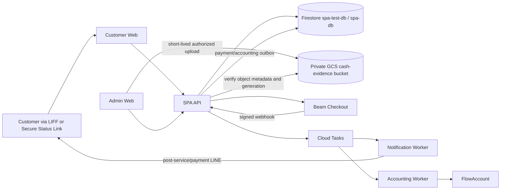

# SPA 49 — Payment & Tip Implementation Action Plan

| Item | Value |
| --- | --- |
| Status | Proposed change set — not yet an approved production baseline |
| Scope | Customer payment after service, optional tip, Admin cash receipt/deposit, Beam Checkout integration, Admin payment visibility |
| Surfaces | Customer Web / LIFF, Admin Web, SPA API, private GCS evidence bucket, Notification Worker |
| Timezone / currency | `Asia/Bangkok` / THB in integer satang |
| Last reviewed | 1 September 2026 |

## 1. Executive decision

Recommended implementation:

1. Keep `BookingStatus` and `PaymentStatus` separate. A completed service is not automatically a successful payment, and a refund must not reopen the Booking state machine.
2. Unlock customer payment only after `Booking.status == COMPLETED` and only when the payment is initiated on the branch-local service date.
3. Put the optional tip selector on the payment review screen and collect service amount plus tip in one provider transaction.
4. Do not create a separate Rich Menu item for tips. Use `Rich Menu → My Bookings` and send a post-service LINE message with one CTA: **ชำระเงินและให้ทิป / Pay & add a tip**.
5. Use Beam Charges API as the preferred path when direct supported banking-app redirect and a downloadable PromptPay QR are hard requirements. Use Beam Payment Links as the lower-complexity fallback if the merchant contract or enabled capabilities do not permit the required Charges API methods.
6. Treat Beam webhooks and subsequent server-side provider lookup as the authoritative payment result. A browser redirect is never proof of payment.
7. Write a durable accounting-export record when payment succeeds. Do not call FlowAccount synchronously from the payment webhook.
8. Support Admin-recorded cash payment, but keep the customer's cash settlement separate from the later movement of branch cash into the merchant bank account.
9. Add an Admin **นำเงินสดเข้าบัญชี / Deposit cash via QR** workflow: enter or confirm the amount, upload cash-photo evidence to a private GCS bucket, create a Beam PromptPay QR, and wait for server-verified success or failure.
10. A cash-deposit QR is a treasury/reconciliation operation, not a second customer sale. It must never create another Booking payment, tip, receipt, or FlowAccount sales export.
11. A `HISTORICAL_RECORD` preserves subtotal, authorized discount, and net financial history but does not infer a payment method or create a paid transaction automatically. Payment/accounting records require separate authoritative payment evidence to avoid duplicate or misclassified revenue.

This design deliberately does not add `PAID` to `BookingStatus`.

## 2. Existing-baseline impact

The current approved artifacts explicitly state that online payment, payment reconciliation, receipt issuance, `PAID`, and customer self-service My Bookings are outside Phase 1:

- `BusinessLogic.md` sections 5.1, 16, 19, and 20
- `HLD.md` sections 3 and 22
- `TDD.md` sections 32 and 33
- `LLD.md` sections 27 and 29

Therefore this work is a Phase 2 business and architecture change, not a small API addition. Before production implementation, update and approve in this order:

1. `BusinessLogic.md`: payment/tip eligibility, cash receipt/deposit rules, refund/correction rules, VAT/tax policy, customer identity, late-payment policy, and acceptance rules.
2. `HLD.md`: Beam and FlowAccount boundaries, cash-evidence GCS boundary, the Accounting Worker, trust boundaries, IAM, secrets, recovery, and operational targets.
3. `TDD.md`: endpoints, schemas, provider/evidence-storage contracts, Firestore collections/indexes, queues, retry rules, rate limits, and monitoring.
4. `LLD.md`: exact types, repositories, cash allocation algorithms, evidence validation, infrastructure resources, frontend routes/components, and tests.
5. UX/UI implementation only after those decisions are approved.

The existing code is currently a preview foundation: Customer Web has no live Booking write/My Bookings implementation, Admin Web uses preview data, and SPA API exposes only branch, catalog, and empty availability endpoints. Payment implementation depends on completing the underlying Booking/authentication foundations or delivering them in the same program.

## 3. Provider clarification: Beam is not yet proven to be a direct UOB API

The supplied documentation is Beam Checkout V1. It does not prove that the prepared key is a direct UOB API credential. Before implementation, verify the credential set and merchant capabilities in Beam Lighthouse/Playground:

- Merchant ID
- Merchant API Key
- Webhook HMAC key
- Playground and production account separation
- Enabled payment methods for this merchant
- Whether the commercial UOB arrangement settles Beam transactions to UOB, or exposes a different UOB API contract

Beam's current Charges documentation lists QR PromptPay and several mobile-banking methods, but it does not list a UOB mobile-app payment method. Do not promise a one-tap redirect to the UOB app until the merchant capability endpoint/account configuration or Beam support confirms it.

The proposed Admin cash workflow also requires explicit commercial confirmation. Using a merchant-generated Beam QR to move staff/branch funds into the same merchant settlement account may be treated as self-funding rather than a customer payment. Finance and Beam/UOB must confirm that this use case is permitted, how provider fees are treated, and which bank account is the source of funds. If it is not permitted, retain the same Admin evidence/reconciliation UX but replace Beam QR with the approved UOB cash-deposit or bank-transfer reference flow.

### 3.1 Integration option decision

| Option | Customer experience | Engineering/security profile | Fit |
| --- | --- | --- | --- |
| Beam Payment Links | Redirect to Beam-hosted checkout, then choose available method | Lowest frontend/payment complexity; single-use links; configurable expiry; no iframe | Best MVP if hosted checkout is accepted; downloading QR is not guaranteed by the documented contract |
| Beam Charges API — bank app | SPA shows an allowlisted bank selector; provider returns `REDIRECT` when supported | More provider-specific UI and device handling; no card data if cards are disabled | Best match for direct bank-app flow, but only for Beam-supported and merchant-enabled apps |
| Beam Charges API — QR PromptPay | SPA displays `ENCODED_IMAGE`, countdown, and Save QR | SPA must safely handle image response and expiry; still avoids card scope | Required if Save QR is a hard acceptance criterion |
| Beam Bolt deep link | Redirects into the merchant's Beam Bolt app/device flow | Intended for merchant-operated Bolt, not a normal customer bank-app checkout | Not recommended for this customer self-service use case |

Recommended delivery path:

- Target Charges API with **mobile banking + QR PromptPay only** when the merchant account supports it.
- Do not accept PAN/CVV or implement card UI in SPA.
- If the merchant arrangement supports only hosted Payment Links, ship Payment Links first and record downloadable QR/direct-bank as a deferred capability rather than simulating it.

### 3.2 Documented mobile-banking request and redirect contract

For direct Charges API requests, use Beam's documented request objects and a real mobile `deviceType`:

| Method | Request object | Required device | Documented app URI scheme |
| --- | --- | --- | --- |
| `KRUNGSRI_APP` | `"krungsri": {}` | `IOS` or `ANDROID` | `krungsri-kma://` |
| `BANGKOK_BANK_APP` | `"bbl": {}` | `IOS` or `ANDROID` | `bualuangmbanking://` |

The API must reject `WEB` for these methods. The browser receives only Beam's reduced `REDIRECT` action. Custom schemes are allowlisted per payment method so one bank's app link cannot be replayed as another bank's redirect. Payment completion remains webhook/provider-lookup authoritative.

## 4. Business rules to approve

### 4.1 Payment eligibility

A customer may initiate a payment only when all are true:

1. Booking exists and is linked to the verified LINE user, or the caller presents the valid Booking Secure Status bearer.
2. Booking is `COMPLETED`.
3. `today(Asia/Bangkok) == booking.localDate`.
4. `amountDueSatang > 0` and `paymentStatus != PAID`.
5. There is no other unexpired `CREATING` or `ACTIVE` payment attempt for the Booking.
6. The Booking has not been placed in `PAYMENT_REVIEW`, refund, or accounting-correction hold.

The API enforces these rules. Hiding a CTA is not a security or business control.

Payment eligibility is recalculated from authoritative server time. The browser and LINE message never decide that the service is completed or that the date is valid.

### 4.2 Date and 15-minute expiry semantics

Recommended interpretation of “pay only on the service date”:

- A new attempt can be **created** only after completion and on the service date.
- A created attempt remains valid for exactly 15 minutes, even if that window crosses midnight.
- Provider `transactionTime`, not webhook arrival time, determines whether the payment occurred within the attempt window.
- If no payment was initiated on the service date, customer self-service closes. An `ADMIN` may issue a late-payment override with reason and audit evidence.

This preserves the full approved 15-minute attempt window when a service completes near midnight. Provider `transactionTime` must still fall inside that immutable attempt window.

### 4.3 Payable amount

At `IN_SERVICE → COMPLETED`, atomically freeze a final payable snapshot:

```text
subtotalAmountSatang = sum(final booking line-item snapshots)
discountAmountSatang = immutable approved Booking discount
serviceAmountSatang = subtotalAmountSatang - discountAmountSatang
tipAmountSatang     = customer-selected optional amount, initially 0
totalAmountSatang   = serviceAmountSatang + tipAmountSatang
currency            = THB
```

- Never calculate the provider amount from mutable catalog prices.
- Preserve original service lines and explicit discount evidence; never rewrite catalogue unit prices to conceal a Booking discount.
- `PER_BOOKING` items remain charge-once; the Couple Package must not be multiplied by pax.
- Once an attempt is created, its tip and total are immutable.
- To change a tip before paying, disable/expire the active attempt and create a new attempt.
- A successful payment must match Booking reference, merchant, currency, and exact total before the system marks it paid.
- Booking price changes after completion are prohibited while an attempt is active. Post-payment correction requires an explicit adjustment/refund workflow.

### 4.4 Tip MVP

Recommended MVP:

- Tip is optional and defaults to **ไม่ให้ทิป / No tip**.
- Offer fixed presets No tip / 20 / 50 / 100 THB plus Custom. Custom remains disabled until Product configures an explicit maximum enforced by the API.
- Show the service subtotal, tip, and final total before creating the provider attempt.
- Store tip as its own financial line item and never merge it into a massage service price.
- Tip is Booking-level in MVP. Do not ask a two-person Booking to split among therapists.
- Therapist allocation, commission, cash-out, payroll, and pooled-tip policy are separate business/accounting work.
- A standalone tip-only payment after the service payment is out of MVP because it creates a second transaction, additional reconciliation, and refund edge cases.

This avoids a separate Rich Menu item and avoids manipulative defaults. If Product later wants a post-payment tip-only path, add it as a distinct `TIP_ONLY` payment purpose.

### 4.5 Payment lifecycle

Canonical Booking-level status:

```text
UNAVAILABLE -> DUE -> PAYMENT_PENDING -> PAID
                   \-> PAYMENT_REVIEW

PAID -> REFUND_PENDING -> PARTIALLY_REFUNDED | REFUNDED
```

Attempt lifecycle:

```text
CREATING -> ACTIVE -> SUCCEEDED
    |         |  \-> FAILED
    |         |  \-> EXPIRED
    |         \----> DISABLED
    \--------------> CREATE_UNKNOWN -> ACTIVE | FAILED | PAYMENT_REVIEW
```

`PAYMENT_PENDING` means a provider attempt exists; it does not mean money was received.

### 4.6 Cash payment and cash-deposit settlement

Cash is now an approved Admin-recorded customer payment method, subject to these invariants:

1. An authorized Admin records the customer cash received against a specific completed Booking with separate service and tip amounts.
2. Recording cash marks the customer obligation `PAID` with `paymentMethod = CASH`; it does not wait for the branch's later bank deposit.
3. The corresponding cash amount becomes `UNSETTLED` in the branch cash ledger and is eligible for one cash-deposit batch.
4. A cash-deposit batch may allocate one or more unsettled cash payments. Its amount must equal the sum of its allocations. Do not allow a free-form amount to silently differ from selected cash receipts.
5. If the modal is opened from one Booking, prefill and lock the allocation to that Booking while keeping the amount visibly reviewable. If opened from the Payment & Accounting page, let Admin select unsettled cash receipts and prefill the calculated total.
6. The cash photo is required operational evidence, but it is not proof that money reached the bank. Only a signature-verified Beam webhook followed by authoritative provider lookup may mark the deposit `COMPLETED`.
7. A Beam cash-deposit attempt uses a separate purpose and reference namespace such as `CASH_DEPOSIT` / `SPA-CASH-DEP-*`; it must never mutate `payments/{paymentId}` to create another sale.
8. A successful deposit atomically marks its allocated cash receipts `SETTLED`. Duplicate or late webhook delivery must not settle an allocation twice.
9. If a deposit expires or fails, the cash receipts are not `SETTLED`; keep them `DEPOSIT_PENDING` while the batch remains open and allow a replacement attempt only after reconciling the old provider Charge. If the batch is cancelled, release them back to `UNSETTLED`. Evidence may be reused only when the same immutable deposit amount and allocations are retained; otherwise create a new deposit record and evidence.
10. Cash overage, shortage, partial deposit, withdrawal, reimbursement, and correction require a distinct variance workflow with reason and approval; they must not be hidden by editing the amount.
11. A cash-paying Walk-in without a Booking must first be recorded by `ADMIN` as a distinct `WALK_IN_SALE` with immutable service/amount snapshots. Only that ledger entry can be allocated to a deposit. Non-revenue cash uses a separate treasury adjustment and creates no customer sale/export.

Recommended cash-deposit lifecycle:

```text
DRAFT -> EVIDENCE_UPLOADING -> READY_FOR_QR -> QR_CREATING -> QR_ACTIVE
                              QR_ACTIVE -> VERIFYING -> COMPLETED
                              QR_ACTIVE -> EXPIRED | FAILED | REVIEW
                              DRAFT | READY_FOR_QR -> CANCELLED
```

`COMPLETED` means the branch cash-deposit transaction was provider-verified. The customer Booking may already be `COMPLETED` and its customer payment `PAID`; these states remain independent.

## 5. Customer UX

### 5.1 Entry points

Preferred entry order:

1. On completion, enqueue a customer-safe LINE Flex message: “บริการเสร็จเรียบร้อยแล้ว” with `ชำระเงินและให้ทิป` CTA.
2. Rich Menu `My Bookings` opens LIFF Customer Web.
3. Secure Status Link remains the fallback for Guests and linked customers.

Do not add “Tip” as a top-level Rich Menu destination. It has no Booking context and creates ambiguity about therapist, amount, and duplicate payment.

### 5.2 My Bookings identity

`My Bookings` is a new authenticated customer feature:

- LIFF obtains a LINE ID token.
- SPA API verifies the token and resolves the trusted LINE User ID.
- API returns only Bookings with an active verified `line_booking_links` relationship.
- Phone number matching is never used to list Bookings.
- Guest customers continue through their single-Booking Secure Status Link; they do not receive a phone-based booking directory.

### 5.3 Booking-card states

| State | Customer content | CTA |
| --- | --- | --- |
| Before service date | Appointment and estimated total | Disabled label: “ชำระได้หลังรับบริการ” |
| Service date, not completed | Current Booking status | Disabled label: “รอจบบริการ” |
| Completed and eligible | Final service amount and payment due | `ชำระเงินและให้ทิป` |
| Active attempt | Method, countdown, amount | `กลับไปชำระเงิน` / `แสดง QR` |
| Paid | Paid total, tip, paid time, method | `ชำระแล้ว`; later receipt link if accounting export succeeds |
| Expired | Clear expiry explanation | `สร้างรายการชำระใหม่` if still eligible |
| Review | Generic safe message and store contact | No duplicate-pay CTA |
| Refunded | Refunded amount/status | Store contact; no new charge without Admin correction |

### 5.4 Payment review and tip screen

Mobile-first screen order:

1. Booking reference and service completion indicator
2. Itemized service snapshot
3. Service subtotal
4. Optional tip choices, with “No tip” selected initially
5. Final total
6. `เลือกวิธีชำระเงิน / Choose payment method`

Tip selection must not be preselected to a positive amount. The final total must update accessibly with an `aria-live` status and remain visible above the primary CTA.

### 5.5 Payment method screen

- Render only methods returned by the server-side merchant allowlist/capability configuration.
- Mobile banking methods appear only on supported mobile devices.
- If the selected method returns `REDIRECT`, navigate the top-level window to the provider URL.
- If it returns `ENCODED_IMAGE`, show QR, remaining time, refresh status, and `บันทึก QR / Save QR`.
- Save QR downloads the in-memory provider image; do not upload the QR to Cloud Storage.
- Never render Beam Payment Links in an iframe because Beam documents `X-Frame-Options: DENY`.
- When bank-app redirect is unavailable, make QR PromptPay the explicit fallback.

### 5.6 Result and recovery

- Use `/payment/result` as the customer return page for both mobile-banking and PromptPay flows. The API appends only the non-secret `attempt` identifier to the configured base return URL.
- The result page must exchange that attempt identifier together with a freshly verified LINE ID token. The API must confirm an active `line_booking_links` ownership record before returning payment details; an attempt identifier is correlation data, not authorization.
- The return page shows “กำลังตรวจสอบ” until SPA's server-side status is authoritative.
- Do not display “ชำระสำเร็จ” from a redirect query string.
- Poll SPA API with bounded exponential backoff for a short period; then show a safe delayed-confirmation state.
- A delayed webhook may update the page to Paid without another charge.
- Before offering retry after an ambiguous result, reconcile the existing provider Charge to prevent duplicate payment.
- Provide store contact for timeout, app-switch failure, or `PAYMENT_REVIEW`.

Required UX states: loading, no linked Bookings, token invalid/expired, service not complete, wrong date, QR expired, bank app unavailable, provider timeout, verification delayed, amount mismatch/review, paid, refunded, and permission denied.

Validate Thai and English at `360x800`, `390x844`, and `430x932`; keep tap targets at least `44x44px` and meet WCAG 2.2 AA.

## 6. Admin UX changes

Add payment information to Booking detail first; the full cross-Booking accounting page is specified in `action_flowaccount.md`.

Booking detail should show:

- Final service amount
- Tip amount
- Paid total
- Payment status
- Payment method
- Provider reference and Charge ID in a copyable operational section
- Attempt expiry/countdown when active
- Paid/refunded timestamps
- FlowAccount export summary
- Safe actions: reconcile provider status, disable active attempt, and Admin late-payment override
- For a cash-paid Booking: cash received amount/time/recorder, allocation status, and linked cash-deposit batch

Financial actions require confirmation, current-version checks, explicit reason where corrective, and an audit event. Health detail must never enter payment logs, provider metadata, accounting export payloads, or payment-table projections.

### 6.1 Record customer cash

On a completed unpaid Booking, authorized Admin sees `บันทึกรับเงินสด / Record cash received`.

The dialog contains:

- Read-only Booking reference, service lines, service total, and current version
- Tip amount input, default `0`, under the same configured validation as online tip
- Read-only final cash total calculated by the server
- Cash-received timestamp, defaulting to server time
- Mandatory confirmation: “ได้รับเงินสดจากลูกค้าแล้ว”
- Primary CTA `ยืนยันรับเงินสด / Confirm cash received`

On success, show `รับเงินสดแล้ว — รอนำเข้าบัญชี / Cash received — awaiting deposit`. Do not combine this action with QR generation: receiving customer cash and depositing branch cash are different auditable events.

Required states: loading, stale Booking version, amount changed, already paid, permission denied, save failed/retry, and success. A second submission with the same idempotency key returns the original result.

### 6.2 Deposit cash via Beam QR

Place the primary CTA `นำเงินสดเข้าบัญชี / Deposit cash via QR` on the Payment & Accounting page and as a contextual action on a cash-paid Booking. Use a large desktop dialog or right-side drawer; do not hide the financial summary below an internal scroll area.

Dialog sequence:

1. **Select and confirm amount**
   - If opened from a Booking, show that unsettled cash receipt and prefill its amount.
   - If opened globally, list unsettled cash receipts with Booking reference, received time, service, tip, and amount. Admin selects one or more rows.
   - Show selected count and calculated total in a sticky summary.
   - Keep the requested amount field visible. It must equal the allocation total; otherwise show an inline variance error and disable progression.
2. **Upload cash evidence**
   - Require one image of the cash being deposited; allow JPEG, PNG, or HEIC within the approved size limit.
   - Show upload progress, preview, filename, replace/remove action, validation failure, and retry.
   - The API issues a short-lived upload authorization. The Admin browser uploads directly to the private evidence bucket and then calls evidence confirmation.
   - Do not enable QR creation until the server verifies the object generation, size, media signature, and evidence state `READY`.
3. **Review**
   - Display branch, amount, allocations, evidence thumbnail, responsible Admin, and a warning that whoever scans the QR is transferring funds to the merchant settlement account.
   - Require final confirmation before creating a provider Charge.
4. **Create and scan QR**
   - CTA: `สร้าง QR สำหรับนำเงินเข้าบัญชี / Create deposit QR`.
   - Display the Beam PromptPay QR, exact amount, batch reference, 30-minute countdown, `บันทึก QR`, and `ตรวจสอบสถานะ`.
   - The QR must be created only after the deposit record and evidence metadata are durable. Do not store the QR image in Firestore or GCS.
   - If the Admin uses the same mobile device, offer the provider-supported bank-app redirect when available; otherwise the expected desktop flow is scanning with a separate banking device.
5. **Verify result**
   - After scanning, show `กำลังตรวจสอบ / Verifying`; never infer success from a return URL or an Admin checkbox.
   - On authoritative success, replace the form with a success dialog showing deposited amount, provider reference, completed time, evidence reference, and affected Booking count.
   - On `FAILED` or `EXPIRED`, show a failure dialog with safe reason, `ตรวจสอบกับ Beam อีกครั้ง`, and `สร้าง QR ใหม่` only after the existing attempt is reconciled.
   - On amount/reference mismatch, move the batch to `REVIEW`, keep allocations unsettled, disable retry, and instruct Admin to contact an authorized manager.

Dialog close/reopen must preserve the durable state. Closing the dialog never cancels or fails a provider attempt. The Payment & Accounting table should show cash-deposit badges `รอหลักฐาน`, `พร้อมสร้าง QR`, `QR ใช้งานอยู่`, `กำลังตรวจสอบ`, `สำเร็จ`, `ล้มเหลว`, `หมดอายุ`, and `ต้องตรวจสอบ`, pairing color with text/icon.

Recommended permissions:

| Action | Permission | Baseline role |
| --- | --- | --- |
| Record customer cash | `cash_payment.record` | `ADMIN` |
| Create/edit draft and upload evidence | `cash_deposit.manage` | `ADMIN` |
| Generate QR and reconcile | `cash_deposit.execute` | `ADMIN` |
| View evidence image | `cash_deposit.evidence.read` | `ADMIN` with branch scope |
| Resolve variance/review | `cash_deposit.approve` | Manager/Finance only |
| Refund or correct payment | `payment.refund` / `payment.correct` | `ADMIN`; non-blank reason required |

Do not expose cash-evidence thumbnails in broad Booking/customer tables. Load them only after an authorized action in the deposit detail view, using a short-lived read URL or authenticated API response.

## 7. Target architecture



Responsibilities:

- **Customer Web:** tip/method selection, bank redirect, QR display/save, customer-safe status.
- **Admin Web:** record customer cash, select unsettled allocations, upload evidence, create/view cash-deposit QR, and monitor verification states.
- **SPA API:** customer/Admin authorization, eligibility, payable snapshot, cash allocation invariants, signed evidence-upload authorization, object confirmation, Beam create/query calls, raw webhook verification, payment/deposit state transactions, audit, and accounting outbox.
- **Private GCS evidence bucket:** durable cash-photo evidence only. It never stores Beam QR payloads, API responses, customer tokens, or health data.
- **Notification Worker:** LINE payment-due and paid messages only; it receives safe projections.
- **Accounting Worker:** private FlowAccount export only, with a separate runtime identity and secrets.

Do not give Customer/Admin Web Firestore, GCS service-account, or Beam credentials. Do not give the Notification Worker FlowAccount secrets. The proposed separate Accounting Worker adds one deployable but preserves least privilege and prevents LINE notification changes from sharing accounting credentials.

## 8. Firestore model

### 8.1 `payments/{paymentId}`

One canonical payment aggregate per Booking for MVP:

```json
{
  "bookingDocId": "internal-booking-id",
  "bookingPublicId": "BK-20260826-001",
  "branchId": "branch_001",
  "purpose": "SERVICE_AND_TIP",
  "status": "DUE",
  "currency": "THB",
  "serviceAmountSatang": 60000,
  "tipAmountSatang": 0,
  "paidAmountSatang": 0,
  "paymentMethod": null,
  "cashSettlementStatus": null,
  "payableSnapshotVersion": 1,
  "activeAttemptId": null,
  "paidAttemptId": null,
  "paidAt": null,
  "provider": "BEAM",
  "version": 1,
  "createdAt": "timestamp",
  "updatedAt": "timestamp"
}
```

### 8.2 `payment_attempts/{attemptId}`

Store provider identifiers and normalized state, never the API key, raw webhook, QR image, or full provider response:

```json
{
  "paymentId": "payment-id",
  "bookingDocId": "internal-booking-id",
  "provider": "BEAM",
  "providerMode": "CHARGE",
  "providerPaymentLinkId": null,
  "providerChargeId": "ch_...",
  "providerReferenceId": "SPA-PAY-payment-id-attempt-id",
  "providerIdempotencyKey": "uuid-v4",
  "paymentMethod": "QR_PROMPT_PAY",
  "actionRequired": "ENCODED_IMAGE",
  "status": "ACTIVE",
  "serviceAmountSatang": 60000,
  "tipAmountSatang": 10000,
  "totalAmountSatang": 70000,
  "currency": "THB",
  "expiresAt": "timestamp",
  "providerTransactionAt": null,
  "lastReconciledAt": null,
  "version": 1,
  "createdAt": "timestamp",
  "updatedAt": "timestamp"
}
```

For an Admin-recorded cash payment, `paymentMethod = CASH` and `cashSettlementStatus = UNSETTLED | DEPOSIT_PENDING | SETTLED | REVIEW`. This field tracks treasury settlement only; the customer-facing payment remains `PAID` after authorized cash receipt.

### 8.3 `cash_deposits/{cashDepositId}`

One immutable-amount deposit batch with evidence metadata and allocation summary:

```json
{
  "branchId": "branch_001",
  "purpose": "CASH_DEPOSIT",
  "status": "READY_FOR_QR",
  "currency": "THB",
  "amountSatang": 120000,
  "allocationCount": 2,
  "allocatedAmountSatang": 120000,
  "evidence": {
    "status": "READY",
    "bucket": "environment-specific-private-bucket",
    "objectName": "cash-deposits/branch_001/2026/08/deposit-id/evidence-id.jpg",
    "generation": "object-generation",
    "contentType": "image/jpeg",
    "sizeBytes": 2450000,
    "sha256": "hex-digest"
  },
  "activeAttemptId": null,
  "completedAttemptId": null,
  "provider": "BEAM",
  "providerReferenceId": null,
  "createdByActorId": "admin-actor-id",
  "completedAt": null,
  "version": 1,
  "createdAt": "timestamp",
  "updatedAt": "timestamp"
}
```

Store GCS `bucket`, `objectName`, and immutable `generation`, not a public URL or an expiring signed URL. Store only internal actor IDs in the object and audit metadata; resolve display names through authorized Admin APIs.

Allocation documents live under `cash_deposits/{cashDepositId}/allocations/{paymentId}` with `paymentId`, Booking reference projection, allocated service/tip/total, and immutable source-payment version. A transactional guard prevents a cash payment from belonging to two open or completed deposits.

### 8.4 `cash_deposit_attempts/{attemptId}`

Cash-deposit provider attempts remain independent from customer `payment_attempts`:

```json
{
  "cashDepositId": "deposit-id",
  "branchId": "branch_001",
  "provider": "BEAM",
  "providerMode": "CHARGE",
  "providerChargeId": "ch_...",
  "providerReferenceId": "SPA-CASH-DEP-deposit-id-attempt-id",
  "providerIdempotencyKey": "uuid-v4",
  "paymentMethod": "QR_PROMPT_PAY",
  "actionRequired": "ENCODED_IMAGE",
  "status": "ACTIVE",
  "totalAmountSatang": 120000,
  "currency": "THB",
  "expiresAt": "timestamp",
  "providerTransactionAt": null,
  "lastReconciledAt": null,
  "version": 1,
  "createdAt": "timestamp",
  "updatedAt": "timestamp"
}
```

### 8.5 Supporting collections

| Collection | Purpose |
| --- | --- |
| `payment_webhook_events` | Signature-verified event deduplication and minimal normalized processing outcome |
| `payment_attempt_guards` | Transactional one-active-attempt guard per Booking |
| `cash_deposit_allocation_guards` | Prevent one cash payment from being allocated to multiple open/completed deposit batches |
| `accounting_exports` | Durable handoff created exactly once from a succeeded payment |
| `audit_events` | Append-only payment eligibility, attempt, success, cash receipt, evidence, deposit, review, disable, override, and refund actions |

`bookings` may contain query-oriented payment summary fields (`paymentStatus`, `amountDueSatang`, `paidAmountSatang`, `paymentUpdatedAt`). They are a denormalized projection updated in the same Firestore transaction as `payments`; they are not a second payment source of truth.

Required index intents include:

- Payments by `branchId + status + updatedAt`
- Payments by `bookingDocId`
- Attempts by `paymentId + status + createdAt`
- Active attempts by `bookingDocId + status + expiresAt`
- Cash payments by `branchId + cashSettlementStatus + paidAt`
- Cash deposits by `branchId + status + updatedAt`
- Cash-deposit attempts by `cashDepositId + status + createdAt`
- Webhook events by provider resource/event key
- Completed Bookings by `branchId + paymentStatus + completedAt`

### 8.6 Private GCS evidence bucket

Provision one new environment-specific bucket dedicated to cash-deposit evidence. Do not reuse receipt, public-asset, or temporary-upload buckets, and do not assume its production name until existing infrastructure, project, region, and naming conventions are inspected.

Required controls:

- Public Access Prevention and uniform bucket-level access
- Bucket location aligned with the approved data-residency and SPA runtime design
- No public ACLs; least-privilege write/verify access for the SPA API runtime and authorized read path for Admin evidence review
- Short-lived, object-specific upload authorization bound to expected content type and deposit/evidence ID
- Server confirmation of object name, generation, maximum size, media signature, checksum, and upload ownership before evidence becomes `READY`
- Accept only approved image formats; normalize or quarantine unsupported/corrupt content before it can be rendered in Admin Web
- Object names contain opaque IDs and branch/date partitions only—never customer name, phone, Booking health data, or Admin name
- Configured retention/lifecycle deletion after the Finance-approved evidence period, with deletion and legal-hold behavior documented
- Access logs and audit events without signed URLs or image contents

Recommended object layout:

```text
cash-deposits/{branchId}/{yyyy}/{mm}/{cashDepositId}/{evidenceId}.{normalizedExtension}
```

The QR returned by Beam remains ephemeral and is never written to this bucket.

## 9. API and internal contracts

### 9.1 Customer API

| Method | Path | Authorization | Purpose |
| --- | --- | --- | --- |
| `POST` | `/api/v1/public/my-bookings:resolve` | Verified LINE ID token in body | Return customer-safe linked Bookings |
| `POST` | `/api/v1/public/bookings/{bookingId}/payment-options` | LINE ID token or Secure Status bearer | Eligibility, final amount, tip options, enabled methods |
| `POST` | `/api/v1/public/bookings/{bookingId}/payment-attempts` | Same bearer plus `Idempotency-Key` | Freeze tip/method and create Beam attempt |
| `POST` | `/api/v1/public/payment-attempts/{attemptId}:resolve` | Verified LINE ID token in body | Resolve the authenticated result page after a Beam return |
| `POST` | `/api/v1/public/payment-status:resolve` | High-entropy payment status bearer | Customer-safe payment result |
| `POST` | `/api/v1/public/payment-attempts/{attemptId}:refresh` | Payment status bearer | Reconcile an ambiguous/expired attempt without creating another |

For bank redirect and QR responses, return only the required action data, provider expiry, and a SPA status bearer. Do not expose Beam credentials or unrestricted provider objects.

### 9.2 Admin API

| Method | Path | Permission | Purpose |
| --- | --- | --- | --- |
| `GET` | `/api/v1/admin/bookings/{bookingId}/payment` | `payment.read` | Full operational payment view |
| `POST` | `/api/v1/admin/bookings/{bookingId}/payments:record-cash` | `cash_payment.record` | Idempotently record customer cash and create an unsettled cash-payment ledger entry |
| `POST` | `/api/v1/admin/payments/{paymentId}:reconcile` | `payment.reconcile` | Query provider and normalize latest state |
| `POST` | `/api/v1/admin/payment-attempts/{attemptId}:disable` | `payment.manage` | Disable a still-active attempt with reason |
| `POST` | `/api/v1/admin/payments/{paymentId}:allow-late-payment` | `payment.manage` | Time-bounded audited exception |
| `POST` | `/api/v1/admin/cash-deposits` | `cash_deposit.manage` | Create an immutable-amount draft from selected unsettled cash-payment allocations |
| `GET` | `/api/v1/admin/cash-deposits/{cashDepositId}` | `cash_deposit.manage` | Return authorized operational state, allocations, evidence metadata, and attempts |
| `POST` | `/api/v1/admin/cash-deposits/{cashDepositId}/evidence-upload:authorize` | `cash_deposit.manage` | Issue short-lived object-specific upload authorization |
| `POST` | `/api/v1/admin/cash-deposits/{cashDepositId}/evidence:confirm` | `cash_deposit.manage` | Verify uploaded object generation/checksum/media and mark evidence ready |
| `POST` | `/api/v1/admin/cash-deposits/{cashDepositId}/attempts` | `cash_deposit.execute` | Create the Beam deposit QR after evidence and allocation checks |
| `POST` | `/api/v1/admin/cash-deposit-attempts/{attemptId}:reconcile` | `cash_deposit.execute` | Query Beam and normalize ambiguous deposit state |
| `POST` | `/api/v1/admin/cash-deposits/{cashDepositId}:cancel` | `cash_deposit.manage` | Cancel only a draft/ready batch without an active or successful attempt |

Both `ADMIN` and `STAFF` may receive `payment.read`. Recommended baseline is `ADMIN` only for cash receipt/deposit, late override, and disable until Product explicitly delegates these financial controls. Manager/Finance approval remains separate for variances and `REVIEW` resolution.

### 9.3 Webhook and private API

| Method | Path | Caller |
| --- | --- | --- |
| `POST` | `/api/v1/webhooks/beam` | Beam with valid `X-Beam-Signature` |
| `POST` | `/internal/v1/payment-attempts/{attemptId}:reconcile` | IAM-authenticated Scheduler/Task identity |
| `POST` | `/internal/v1/cash-deposit-attempts/{attemptId}:reconcile` | IAM-authenticated Scheduler/Task identity |

Add stable errors such as `PAYMENT_NOT_ELIGIBLE`, `PAYMENT_DATE_CLOSED`, `PAYMENT_ALREADY_PAID`, `PAYMENT_ATTEMPT_ACTIVE`, `PAYMENT_ATTEMPT_EXPIRED`, `PAYMENT_PROVIDER_UNAVAILABLE`, `PAYMENT_AMOUNT_MISMATCH`, `PAYMENT_REVIEW_REQUIRED`, `CASH_ALLOCATION_CONFLICT`, `CASH_DEPOSIT_AMOUNT_MISMATCH`, `CASH_EVIDENCE_REQUIRED`, `CASH_EVIDENCE_INVALID`, `CASH_DEPOSIT_ATTEMPT_ACTIVE`, and `CASH_DEPOSIT_REVIEW_REQUIRED`.

Evidence-upload authorization, object paths, and evidence-download URLs are operational secrets. Return them only to branch-scoped authorized Admin sessions, keep their expiry short, apply `Cache-Control: no-store`, and never place them in logs, audit payloads, tasks, or analytics.

## 10. Critical transaction and provider flows

### 10.1 Complete service and open payment

```text
Firestore transaction:
  require Booking.status == IN_SERVICE
  finalize Booking and health snapshots
  calculate final service amount from Booking line-item snapshots
  set Booking.status = COMPLETED
  create/update payments/{paymentId} as DUE
  write PAYMENT_DUE notification outbox if LINE linked
  append audit
```

No provider call occurs inside this transaction.

### 10.2 Create an attempt

```text
validate customer bearer and branch-local eligibility
validate tip and allowlisted method

Firestore transaction A:
  re-read Booking, Payment, and active-attempt guard
  require not paid and no active attempt
  create attempt as CREATING with stable provider idempotency UUID
  acquire guard

call Beam using x-beam-idempotency-key from attempt

Firestore transaction B:
  store provider resource ID, normalized action, expiry, state ACTIVE
  update Payment to PAYMENT_PENDING

return REDIRECT or ENCODED_IMAGE action to Customer Web
```

If the API crashes after the Beam call, reconciliation repeats the provider POST with the same Beam idempotency key within Beam's documented 12-hour retention and resolves `CREATE_UNKNOWN` without generating a second charge.

### 10.3 Webhook success

```text
read exact raw request bytes
verify X-Beam-Signature using constant-time HMAC-SHA256 comparison
validate event type and derive dedupe key
persist minimal RECEIVED event if new
return 2xx quickly after durable acceptance

worker/API reconciliation:
  GET authoritative Beam Charge/Payment Link
  verify merchant, provider reference, source, currency, and exact amount
  Firestore transaction:
    require payment not already paid
    mark attempt SUCCEEDED
    mark Payment PAID and Booking payment projection PAID
    create accounting_exports record exactly once
    append customer-paid notification outbox and audit
```

Beam webhooks are at-least-once and may arrive out of order. Event order must never directly overwrite a newer terminal provider state.

### 10.4 Record cash, upload evidence, and settle deposit

```text
record customer cash transaction:
  require Admin cash_payment.record and branch scope
  require Booking COMPLETED, customer payment not PAID, and exact expectedVersion
  validate service/tip/total and confirmation
  mark Payment PAID with paymentMethod CASH
  mark cashSettlementStatus UNSETTLED
  create accounting_exports sales candidate exactly once
  append cash-received audit

create cash-deposit draft transaction:
  require every selected Payment is CASH + PAID + UNSETTLED
  require amount == sum(allocations)
  acquire one allocation guard per Payment
  create cash_deposits DRAFT and allocation documents
  mark source Payments cashSettlementStatus DEPOSIT_PENDING
  append deposit-draft audit

authorize and confirm evidence:
  create opaque evidence ID and expected object name
  return short-lived object-specific upload authorization
  Admin Web uploads directly to private GCS bucket
  confirmation API verifies object name, generation, size, media signature, and checksum
  persist evidence bucket/objectName/generation/checksum as READY
  move CashDeposit to READY_FOR_QR and append evidence audit

create Beam QR:
  Firestore transaction A requires READY_FOR_QR, evidence READY, exact version,
    allocations unchanged, amount matched, and no active attempt
  create cash_deposit_attempts CREATING with stable Beam idempotency UUID
  call Beam outside Firestore transaction using reference SPA-CASH-DEP-*
  Firestore transaction B stores Charge/action/expiry and moves batch to QR_ACTIVE
  return ENCODED_IMAGE to authorized Admin Web without persisting QR payload

Beam webhook/reconciliation:
  verify signature and retrieve authoritative Charge
  route by trusted stored provider reference, never client input
  verify merchant, source, currency, reference, and exact deposit amount
  Firestore transaction:
    mark attempt SUCCEEDED and CashDeposit COMPLETED exactly once
    mark every guarded allocation's source Payment cashSettlementStatus SETTLED
    release/close allocation guards as terminal ownership records
    append deposit-completed audit
  do not create a second accounting sales export or customer-paid notification
```

If evidence upload succeeds but confirmation fails, keep the deposit recoverable and allow the same object generation to be re-verified. If draft cancellation succeeds before QR creation, mark source cash payments `UNSETTLED` and release allocation guards atomically; queue the orphaned evidence object for lifecycle cleanup rather than deleting it inside the transaction.

## 11. Security and privacy controls

- Store Beam Merchant API Key and webhook HMAC key in Secret Manager; never use `NEXT_PUBLIC_*`.
- Use separate test and production secrets and webhook endpoints.
- Use HTTP Basic authentication only from server-side integration code over HTTPS.
- Decode the base64 webhook HMAC key as Beam documents, calculate HMAC-SHA256 over the exact raw request bytes, and use a constant-time signature comparison.
- Allowlist HTTPS provider hosts and exact method-scoped bank-app URI schemes; validate every redirect returned by Beam before sending it to the browser. Never allow a custom scheme globally or reuse one bank's scheme for another payment method.
- Never log Authorization, API key, webhook body, QR raw data, customer phone, LINE token, status bearer, or health detail.
- Never log evidence upload/read URLs, cash-photo contents, object checksums, or unrestricted GCS paths.
- Do not put health detail, full phone, nickname, or internal Firestore IDs into Beam `referenceId` or provider metadata.
- Do not place customer/Admin names or phone numbers in evidence object names or image metadata. Normalize supported images and remove metadata where practical before long-term storage or display.
- Rate-limit attempt creation by customer/Booking, evidence authorization/confirmation, cash-deposit QR creation, and Admin corrective actions.
- Use high-entropy payment status bearers stored only as digests, following the existing Secure Status Link pattern.
- Apply `Cache-Control: no-store, private` to all payment pages and responses.
- Add CSP `connect-src`/navigation allowlists for Beam and avoid iframe embedding.
- Enforce branch-scoped authorization on cash deposits and evidence. A valid object name alone never grants read access.
- Audit payment/evidence access and every financial mutation without storing secrets, signed URLs, image bodies, or raw provider bodies.

Proposed Secret Manager containers:

- `spa-beam-merchant-id`
- `spa-beam-merchant-api-key`
- `spa-beam-webhook-hmac-key`

The API runtime identity receives access only to these exact secrets. Human access remains limited and audited.

## 12. Reliability and reconciliation

- Send `x-beam-idempotency-key` on every Beam `POST`/`PATCH`; retain the key with the attempt.
- Retry Beam `429`, `5xx`, and timeouts with exponential backoff and jitter using the same idempotency key.
- Never create a new attempt merely because the browser did not receive a response.
- Reconcile stale `CREATING`, `CREATE_UNKNOWN`, and `ACTIVE` attempts against Beam.
- Expiry is a provider and local state; a local timer alone is not proof that a late webhook failed.
- Store Charge ID because refunds and final payment detail are Charge-scoped even when Payment Links are used.
- Disable unused active Payment Links/attempts when a replacement is issued, where the provider contract supports it.
- Payment success and accounting export commit atomically in Firestore; external FlowAccount delivery is asynchronous.
- Reconcile stale cash-deposit `QR_CREATING`, `QR_ACTIVE`, and `VERIFYING` states separately from customer payment attempts.
- Never regenerate a deposit QR after timeout until the existing provider idempotency result/Charge is resolved.
- Make evidence confirmation idempotent by `(cashDepositId, objectName, generation)`; a retry must not create another evidence record.
- Use a cleanup job for abandoned uploads and cancelled-draft evidence according to the approved retention policy.

## 13. Observability

Metrics without Booking/payment IDs as labels:

```text
spa_payment_attempt_count{method,result}
spa_payment_attempt_age_seconds{state}
spa_payment_webhook_count{event_type,result}
spa_payment_reconcile_count{result}
spa_payment_success_count{method}
spa_payment_amount_mismatch_count
spa_payment_due_age_seconds{age_band}
spa_tip_amount_satang_sum
spa_cash_payment_unsettled_amount_satang{branch}
spa_cash_deposit_count{status}
spa_cash_deposit_amount_satang_sum{status}
spa_cash_evidence_upload_count{result}
spa_cash_deposit_attempt_age_seconds{state}
```

Alerts:

- Signature failures above a low threshold
- `CREATING`/`CREATE_UNKNOWN` older than five minutes
- Active attempt older than provider expiry plus grace
- Provider success with amount/reference mismatch
- Completed-and-unpaid Booking older than agreed threshold
- Beam dependency/error spike
- Payment succeeded but accounting export record missing
- Cash payment remains `UNSETTLED` beyond the Finance-approved threshold
- Cash-deposit amount differs from guarded allocation sum
- Evidence uploaded but not confirmed beyond the cleanup threshold
- Cash-deposit attempt remains creating/verifying beyond the operational threshold
- Provider success for a cash deposit with amount/reference mismatch

Logs include request/correlation IDs, provider resource IDs, safe error code, latency, method, and state transition. They exclude money-party identity, signed URLs, unrestricted evidence paths, and all protected data.

## 14. Implementation work packages

### WP0 — Requirements and provider proof

- Approve the document sequence change and business rules.
- Verify Beam credentials/capabilities in Playground without writing secrets to the repository.
- Verify provider behavior against the approved 15-minute customer-attempt expiry; cash-deposit QR expiry remains a separately configured treasury setting.
- Confirm service-date/15-minute boundary and late-payment policy.
- Confirm tip presets, maximum, ownership, refund behavior, and tax/accounting treatment.
- Confirm Beam/UOB permits the proposed Admin self-funding/cash-deposit QR use case and document provider fees, settlement account, limits, and prohibited sources.
- Confirm cash-receipt/deposit roles, evidence retention, supported image formats/size, variance approval, and maximum unsettled duration.

### WP1 — Payment domain and persistence

- Add payment/cash-deposit enums, eligibility policy, amount snapshot, allocation invariants, repositories, Firestore documents/indexes, audit types, and projection code.
- Update completion transaction to create Payment Due and notification outbox atomically.
- Add one-active-attempt and one-paid-payment invariants.
- Add idempotent Admin cash receipt, allocation guards, deposit cancellation, and cash settlement projections.

### WP2 — Beam adapter and webhook

- Implement typed Beam client with timeouts, idempotency, allowlisted URLs, error classification, and safe logs.
- Implement Charges API QR/redirect actions or approved Payment Links fallback.
- Implement raw-body webhook verification, dedupe, authoritative lookup, state transition, and stale-attempt reconciliation.
- Route customer and cash-deposit references to separate aggregates; implement idempotent cash-deposit QR/reconciliation without creating sales exports.

### WP3 — Customer UX and LINE

- Implement verified My Bookings.
- Implement Booking payment states, tip review, method selection, QR save/countdown, redirect, pending/success/recovery states.
- Add payment-due and paid LINE templates using customer-safe projections.
- Validate TH/EN, accessibility, and mobile viewports.

### WP4 — Admin operations

- Add Payment section to Booking detail.
- Add provider reconcile, attempt disable, and late-payment override with permission checks, confirmation, optimistic concurrency, and audit.
- Add record-cash dialog and the cash-deposit drawer: allocation/amount validation, evidence upload progress/preview/retry, review, QR/countdown/save, verifying, completed, failed, expired, and review states.
- Link to the Payment & Accounting page defined in `action_flowaccount.md`.

### WP5 — Infrastructure and release

- Provision Beam secrets without secret versions in Terraform; inject values through the approved operational process.
- Provision the new private cash-evidence GCS bucket, lifecycle/retention policy, least-privilege IAM, signed-upload/read path, validation/cleanup processing, and audit configuration.
- Add webhook configuration, CSP/CORS changes, metrics, alerts, and cash-deposit/recovery runbook.
- Execute Playground contract tests, provider test cases, controlled production smoke payment, and rollback procedure.

## 15. Verification matrix

Minimum automated evidence:

- Eligibility before service date, on service date before completion, after completion, after date closure, and Admin late override
- Asia/Bangkok boundary and attempt crossing midnight
- `PER_BOOKING` charge-once and two-participant totals
- Tip zero/default, presets, custom validation, and immutable attempt total
- Two concurrent create attempts produce one active provider attempt
- Retried Beam POST uses the same provider idempotency key
- QR expiry, Save QR, refresh, and bank-app unavailable fallback
- Invalid webhook signature creates no business change
- Duplicate and out-of-order webhooks produce one paid transition
- Redirect without webhook/provider success never displays Paid
- Provider reference/currency/amount mismatch moves to review
- Payment success creates exactly one accounting export
- Admin cash receipt marks the customer payment paid once, creates one sales export, and leaves cash settlement `UNSETTLED`
- Cash-deposit amount must equal allocations; concurrent batches cannot allocate the same cash payment
- Evidence upload authorization is branch-scoped and expires; wrong object/generation, oversized, corrupt, or unsupported content never becomes `READY`
- Evidence confirmation retry is idempotent; signed upload/read URLs and image contents do not enter logs or audit payloads
- QR creation is blocked before evidence `READY`, uses one active cash-deposit attempt, and never persists the QR image
- Cash-deposit webhook duplicate/out-of-order delivery settles allocations exactly once and creates no second sale/accounting export
- Failed/expired deposit leaves allocations recoverable; mismatch moves to `REVIEW` and blocks duplicate retry
- No health/full phone/token/QR/provider secret in public response, task, log, metric, or audit
- Linked LINE user sees only linked Bookings; phone-only lookup cannot list Bookings
- TH/EN UI checks at `360x800`, `390x844`, and `430x932`
- Admin permissions, stale `expectedVersion`, confirmation, and audit cases
- Admin cash dialogs in TH/EN with keyboard-only operation, dialog focus return, error/live states, and evidence preview authorization at `1280px`, `1440x900`, and `1920x1080`

Provider/UAT evidence:

- Playground QR payment success/failure/expiry
- Each enabled banking-app redirect on supported iOS and Android devices
- App not installed / browser unsupported recovery
- Webhook retry and delayed delivery
- Provider `429`, `5xx`, and timeout behavior
- Approved cash-deposit QR success/failure/expiry using the actual settlement account and authorized source-of-funds test case
- Confirmation from Beam/UOB that the Admin cash-deposit/self-funding pattern is contractually permitted
- Production credentials and webhook endpoint isolated from test

## 16. Acceptance criteria

1. A customer cannot create a payment before the Booking is `COMPLETED`.
2. A normal customer can initiate only on the service date under approved boundary semantics.
3. A customer payment attempt expires within the approved 15-minute policy and cannot be reused after success.
4. The customer may choose no tip without friction; positive tip is never preselected.
5. Service, tip, and total are visible and stored separately.
6. Supported mobile-banking redirect works only for enabled methods/devices, with QR fallback.
7. PromptPay QR can be saved locally without storing the image in SPA's durable database.
8. Redirect alone never marks the payment paid.
9. Signature-verified, amount-matched provider success marks the Payment paid exactly once.
10. Booking lifecycle remains `COMPLETED`; payment/refund states are independent.
11. Payment success creates exactly one durable FlowAccount export candidate.
12. Admin can inspect and safely reconcile ambiguous payments; corrective actions are authorized and audited.
13. No secrets, health detail, customer tokens, or full phone numbers leak into provider metadata, logs, tasks, or public projections.
14. Authorized Admin can record exact customer cash against a completed Booking idempotently; customer payment becomes `PAID` while cash settlement remains separately visible.
15. Admin can create a cash-deposit batch only from eligible unsettled cash payments, and the entered amount must equal its guarded allocation total.
16. Admin must upload server-verified cash evidence to the dedicated private GCS bucket before a deposit QR can be created; Firestore stores bucket/object/generation metadata and never a public URL.
17. Beam cash-deposit QR success is accepted only after signed webhook plus authoritative amount/reference verification; success settles each allocation exactly once.
18. A cash-deposit transaction never produces another Booking payment, customer receipt, tip, paid notification, or FlowAccount sales export.
19. Admin receives explicit completed, failed, expired, and review outcomes with safe recovery that prevents duplicate transfer.

## 17. Decisions required before coding

| Decision | Recommendation | Owner |
| --- | --- | --- |
| Beam/UOB credential type and enabled methods | Verify in Beam Playground/Lighthouse; do not infer from key name | Product/Operations + Engineering |
| Provider integration | Charges API for redirect + downloadable QR; Payment Links fallback | Product + Engineering |
| Calendar-day boundary | **Confirmed:** initiation must be on service date; active attempt may complete within its 15-minute window | Product |
| Late unpaid Booking | **Confirmed:** `ADMIN` override window is 15 minutes and requires reason/audit | Product/Operations |
| Tip presets and maximum | **Partially confirmed:** No tip / 20 / 50 / 100 THB + Custom; exact Custom maximum still required | Product |
| Tip ownership/allocation | Booking-level store tip in MVP; therapist payout deferred | Product/Finance |
| Cash/manual payments | **Confirmed:** authorized Admin can record customer cash; customer payment becomes `PAID`, while branch cash settlement is tracked separately | Product/Finance |
| Admin cash-deposit UX | **Confirmed direction:** amount/allocation review → required cash-photo upload → create Beam QR → server-verified completed/failed/review state | Product/Operations + Engineering |
| Beam QR for cash settlement | Verify that merchant self-funding/branch-fund transfer is permitted; otherwise use approved UOB deposit/transfer reference behind the same Admin workflow | Finance + Beam/UOB + Engineering |
| Cash evidence GCS policy | New private environment-specific bucket; approve region, image size/formats, retention/deletion, evidence viewers, and legal hold | Security/Finance + Engineering |
| Cash variance handling | Block silent mismatch; Manager/Finance-only overage, shortage, partial-deposit, and correction workflow | Finance/Operations |
| Refund authority and workflow | **Confirmed:** `ADMIN` only; every refund/correction requires a non-blank reason and audit | Product/Finance |
| Tax/VAT treatment | **Confirmed:** customer-visible prices include VAT 7%; `SPA-TIP` remains a separate VAT-inclusive line | Finance/accountant |

## 18. Official references

- [Beam introduction and environments](https://docs.beamcheckout.com/get-started/introduction)
- [Beam authentication](https://docs.beamcheckout.com/get-started/authentication)
- [Beam request idempotency](https://docs.beamcheckout.com/get-started/idempotency-request)
- [Beam Payment Links](https://docs.beamcheckout.com/payment-links/payment-links)
- [Beam Payment Links integration](https://docs.beamcheckout.com/payment-links/payment-links-integration)
- [Beam Charges API](https://docs.beamcheckout.com/charges/charges-api)
- [Krungsri Pay with krungsri app](https://developers.krungsri.com/usecases/payment/pay-with-krungsri-app)
- [Bangkok Bank App-to-App API](https://apiportal.bangkokbank.com/th/api/app-to-app/api-documents)
- [Beam Charges integration](https://docs.beamcheckout.com/charges/charges-integration)
- [Beam webhook authentication](https://docs.beamcheckout.com/webhook-authentication)
- [Beam webhook event types](https://docs.beamcheckout.com/webhook-event-types)
- [Beam go-live checklist](https://dev.docs.beamcheckout.com/go-live-checklist)
